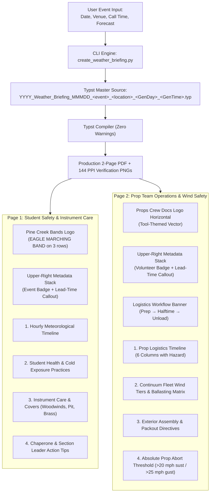

# Generate Operational Weather Briefing

This skill provides an automated engineering pipeline and standardized Typst publishing workflow for creating professional, two-page operational weather briefings for the **Pine Creek High School Marching Band (PCHSMB)**.

---

## 1. When to Use This Skill

Activate this skill whenever:
- Preparing for an upcoming football game, regional competition (CBA, BOA, WGI), or marching travel event.
- Providing band directors, booster coordinators, chaperones, and volunteer prop crews with an actionable, weather-grounded operations plan.
- Re-evaluating field prop wind safety and ballasting tiers based on updated National Weather Service (NWS) or mesoscale weather forecasts.
- Establishing severe weather mitigation (freeze warnings, high gusts, heavy precipitation, lightning thresholds, thermal exposure, instrument protection).

---

## 2. Invariant Rules & Structural Standards

Every generated briefing must strictly adhere to the following invariants:



### Invariant 1: Absolute Two-Page Hard Boundary
The briefing is designed as a physical double-sided laminated clipboard sheet or 2-page pocket folio. **Content must never overflow onto Page 3.**

### Invariant 2: Standardized Filename (with Anti-Overwrite Generation Timestamp)
To prevent accidental file overwrites when issuing multiple forecast revisions across tournament week or on game day (morning vs. midday vs. pre-game updates), every briefing must include the generation day and time rounded to the nearest 15 minutes:

$$\mathbf{YYYY\_Weather\_Briefing\_MMMDD\_<event>\_<location>\_<GenDay>\_<GenTime>.[typ | pdf]}$$

Where:
- `YYYY`: 4-digit event year (e.g. `2026`)
- `MMMDD`: Event date month & day (e.g. `Oct24`)
- `<event>`: Sanitized event descriptor (e.g. `State_Championship`, `Football_Game`)
- `<location>`: Sanitized performance venue (e.g. `Falcon_Stadium`)
- `<GenDay>`: Generation date month & day (e.g. `Oct16`)
- `<GenTime>`: 24-hour generation time rounded to nearest 15 minutes (`HHMM`, e.g. `1030`, `1445`, `0845`)

*Examples:*
- `2026_Weather_Briefing_Oct24_State_Championship_Falcon_Stadium_Oct16_1030.typ`
- `2026_Weather_Briefing_Oct15_Football_Game_Falcon_Stadium_Oct15_0845.typ`
- `2026_Weather_Briefing_Oct15_Football_Game_Falcon_Stadium_Oct15_1200.typ`

### Invariant 3: Distinct Brand Partitioning
- **Page 1 (Student Safety):** Uses `PCHSMB/Graphics/Pine Creek Bands Logo.svg` with official baton/sails emblem and `E A G L E` / `MARCHING` / `B A N D` on 3 rows (zero footer text).
- **Page 2 (Prop Operations):** Uses `PCHSMB/Graphics/Props Crew Docs Logo Horizontal.svg` with screw/saw-blade emblem and `PROPS CREW` text.

### Invariant 4: Visible Lead-Time & 15-Minute Rounded Issue Timestamp
The upper right header of both pages must display an issue timestamp (rounded to the nearest 15 minutes) and lead-time callout:
- Issue Timestamp: `ISSUED: MMM DD, YYYY • H:MM AM/PM` (e.g. `ISSUED: OCT 16, 2026 • 10:30 AM`)
- Day-of-event: `X.X hrs before event (H:MM AM/PM)` (e.g. `4.2 hrs before event (4:15 PM)`)
- Days prior: `X days before event (MMM DD)` (e.g. `8 days before event (Oct 24)`)

### Invariant 5: Hardware & Rigging Facts
- **No Wheel Brakes on Prop Carts:** Casters are free-rolling. *Use a spare 15-lb sandbag to chock wheels on downhill and/or downwind side.*
- **Wooden Rear Rail on Backdrops:** The rear rail is wood. Condensation must be wiped dry before applying Gorilla Tape across Body Bags.
- **Turf Compaction Ceiling:** Maximum supplemental ballast is restricted to **140 lbs** per prop cart.
- **NO-GO Abort Threshold:** If sustained winds exceed **20 mph** OR peak gusts exceed **25 mph**, props remain in trucks.

### Invariant 6: Mandatory National Weather Service (NWS) Live Forecast Data
Under **NO CIRCUMSTANCES** may meteorological data (temperatures, wind speeds, peak gusts, precipitation probabilities, lightning risks, active alerts) ever be synthesized, guessed, or fabricated.
- All weather data **MUST be pulled directly from the National Weather Service API (`api.weather.gov`)** for the exact venue coordinates:
  - **Falcon Stadium (USAFA):** `38.9972, -104.8436` $\to$ NWS Pueblo (`PUB`) Grid `90,99`.
  - **Pine Creek High School (PCHS):** `38.9740, -104.7645` $\to$ NWS Pueblo (`PUB`) Grid `94,98`.
- Required NWS endpoints to query:
  - Hourly Forecast: `https://api.weather.gov/gridpoints/{office}/{gridX},{gridY}/forecast/hourly`
  - Grid Data (Gusts, Thunder, Apparent Temp): `https://api.weather.gov/gridpoints/{office}/{gridX},{gridY}`
  - Active Alerts: `https://api.weather.gov/alerts/active?point={lat},{lon}`
  - Area Forecast Discussion (AFD): `https://api.weather.gov/products/types/AFD/locations/{office}`

### Invariant 7: Conditional 3-Page Forecast Revision & Operations Delta Report
When issuing an updated forecast revision for an event where an earlier briefing already exists in the repository:
- If and only if the user explicitly requests the change page, append a dedicated **Page 3: FORECAST REVISION & OPERATIONS DELTA REPORT**.
- Page 3 must contain:
  1. Executive Delta Summary Banner highlighting key meteorological and operational shifts.
  2. Side-by-side comparative table by championship phase (`Baseline` vs. `Live NWS Update`, `Forecast Delta ($Delta$)`, `Operational Impact & Crew Protocol`, and `Action Status` badge).
  3. Two-column deep-dive: Prop Crew Rigging Adaptations vs. Student Safety & Instrument Care Adaptations.
  4. Role-by-Role Action Checklist (Directors & Staff, Chaperones, Volunteer Prop Crew, Front Ensemble & Techs).
- The dynamic page footer automatically displays `Page X of 3` via `#counter(page).display() of #counter(page).final().first()`. Standard standalone 2-page briefings remain strictly 2 pages when no change page is requested.

---

## 3. Automated Generation via CLI

The skill provides an automated generator script at `scripts/create_weather_briefing.py`:

```bash
# Example: Generate briefing for Falcon Stadium Game Night
python3 .agents/skills/generate-weather-briefing/scripts/create_weather_briefing.py \
  --date 2026-10-15 \
  --event-name "Football Game" \
  --venue "Falcon Stadium (USAFA)" \
  --venue-short "Falcon Stadium" \
  --venue-elevation "6,650'–7,200' ASL" \
  --unload-location "PCHS Loading Dock & Band Room" \
  --unload-short "PCHS" \
  --call-time "16:15" \
  --kickoff-time "18:00" \
  --halftime-time "19:45" \
  --ballast-tier 2 \
  --compile
```

### Script Execution Flow:
1. Calculates exact hours/days between generation timestamp and call time.
2. Populates master template (`templates/weather_briefing_template.typ`).
3. Compiles production `.pdf` and 144 PPI page verification PNGs.
4. Audits page count to ensure zero overflow beyond Page 2.

---

## 4. Required Weather Briefing Inputs

When requesting a weather briefing, provide:
1. **Date & Event:** e.g., October 15, 2026 (Football Game vs. Rival).
2. **Venue Details:** Performance stadium name and elevation.
3. **Logistics Venue:** Return location for teardown/unload (e.g., PCHS Loading Dock).
4. **Key Timeline Benchmarks:**
   - Call Time / Truck Load Time
   - Arrival & Warmup Time
   - Game Kickoff / Performance Time
   - Halftime / Egress Time
   - Post-Game Convoy & Unload Time
5. **Meteorological Parameters (Forecast):**
   - Hourly ambient temperatures and "feels like" wind chills
   - Sustained wind speed and peak gust velocity
   - Precipitation probability and precipitation type (rain, snow, ice)
   - Lightning / thunderstorm threat level
   - Active NWS advisories (Freeze Warning, High Wind Warning, Wind Advisory)
