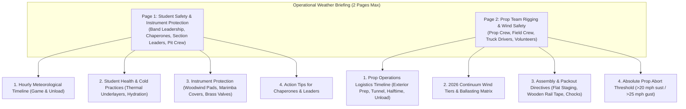

# PCHSMB Operational Weather Briefing Standards & Architecture

## 1. Document Purpose & Structure

The Operational Weather Briefing is a mission-critical, two-page field deliverable produced for outdoor football games, marching band competitions, and travel performances. It translates complex meteorological forecasts (NWS, mesoscale models, stadium microclimates) into actionable safety protocols for two distinct audiences:



---

## 2. Invariant Naming Convention (Anti-Overwrite Timestamp Standard)

Every operational weather briefing must strictly follow the repository naming standard:

$$\mathbf{YYYY\_Weather\_Briefing\_MMMDD\_<event>\_<location>\_<GenDay>\_<GenTime>.[typ | pdf]}$$

To prevent accidental file overwrites when issuing updated briefings across tournament week or on game day (morning vs. midday vs. pre-game updates), every filename incorporates the generation day (`<GenDay>`) and generation time rounded to the nearest 15 minutes (`<GenTime>`, 24-hour `HHMM`).

**Canonical Examples:**
- `2026_Weather_Briefing_Oct24_State_Championship_Falcon_Stadium_Oct16_1030.typ`
- `2026_Weather_Briefing_Oct15_Football_Game_Falcon_Stadium_Oct15_0845.typ`
- `2026_Weather_Briefing_Oct15_Football_Game_Falcon_Stadium_Oct15_1200.typ`
- `2026_Weather_Briefing_Nov07_BOA_Super_Regional_Lucas_Oil_Stadium_Nov06_1430.typ`

Never add arbitrary informal suffixes like `_v2`, `_final`, or development build tokens (`_D24`) to the distributed filename.

---

## 3. Invariant Branding & Logo Standard

To maintain strict program identity between general student operations and equipment crew operations:

| Document Section | Header Logo Asset | Font & Branding | Text Wording |
|---|---|---|---|
| **Page 1 (Student & Instrument Safety)** | `PCHSMB/Graphics/Pine Creek Bands Logo.svg` | True Copperplate vector | `E A G L E` <br/> `MARCHING` <br/> `B A N D` (3 rows, no footer) |
| **Page 2 (Prop Operations & Rigging)** | `PCHSMB/Graphics/Props Crew Docs Logo Horizontal.svg` | True Copperplate vector | `PROPS` <br/> `CREW` (screw & saw-blade emblem) |

---

## 4. Metadata Box & Lead-Time Standard

In the upper-right corner of the header banner on both pages, a dedicated metadata stack displays:

```
┌───────────────────────────────────────┐
│     GAME NIGHT BRIEFING               │  <- Dark Blue Box (#2b6cb0)
│     Falcon Stadium & PCHS             │     Event Type & Venues
└───────────────────────────────────────┘
┌───────────────────────────────────────┐
│  ISSUED: OCT 15, 2026 • 8:40 AM       │  <- Charcoal Box (#1a202c) with Silver Border
│  7.5 hrs before event (4:15 PM)       │     Gold Highlight (#fbd38d) Lead-Time Callout
└───────────────────────────────────────┘
```

### Lead-Time Calculation Rules:
1. **Day-of-Event Generation:**
   - Display: `<hours> hrs before event (<call_time>)`
   - Example: `7.5 hrs before event (4:15 PM)`
2. **Advance Generation (1–3 Days Prior):**
   - Display: `<days> days before event (<event_date>)`
   - Example: `2 days before event (Oct 17)`
3. **Multi-Day Planning (>3 Days Prior):**
   - Display: `ADVANCE PLANNING FORECAST • VALID THROUGH <event_date>`

---

## 5. Dual-Venue Meteorological Modeling

Marching events rarely occur in a single microclimate. Briefings must model the physical geographic separation between performance and logistics:

1. **Performance Venue (Stadium Bowl):**
   - Often high altitude (e.g. Falcon Stadium at ~6,650'–7,200' ASL).
   - Severe wind channel / venturi tunneling through entrance ramps and open end zones.
   - Significant "heat sink" cooling from concrete and aluminum bleachers.
2. **Post-Game Logistics Venue (Loading Dock / Band Room):**
   - Timing is typically late evening (10:00 PM – 11:30 PM).
   - High risk of sub-freezing frost formation on metal truck ramps and roll-up doors under NWS Freeze Warnings.
   - Crew fatigue combined with dropping temperatures requires strict team-lift protocols.

---

## 6. Instrument Protection Standards

| Instrument Group | Environmental Threat | Operational Mitigation |
|---|---|---|
| **Woodwinds** (Flute, Clarinet, Saxophone) | Moisture and humidity swell bladder/leather pads, causing air leaks and poor seal. | Clear plastic rain bags/hoods draped over instruments in stands. |
| **Wooden Instruments** (Grenadilla Oboe, Clarinet) | Thermal shock: blowing warm $98^\circ\text{F}$ moist breath into a near-freezing wooden bore causes expansion stress and body cracks. | Warm instrument gradually inside coat before playing; swab bore condensation frequently. |
| **Front Ensemble (Pit)** | Rosewood marimba bars are porous and detune/swell in dampness. Audio electronics and mixers short on wet turf. | Clear vinyl fitted covers on all mallet percussion until 5 minutes before halftime staging. Elevate power strips and direct boxes off wet ground. |
| **Brass** | Piston valves and rotary valves become sluggish below $40^\circ\text{F}$ as oil thickens. Water key drainage creates ice hazards. | Apply low-viscosity synthetic valve oil before performance. Empty water keys into absorbent rag, never onto bleacher walkways. |

---

## 7. Prop Fleet Wind Tiers & Wheel Chocking Standard

### Authoritative Continuum Ballast Schedule (Hybrid Tube Sand):

| Tier | Sustained Wind | Peak Gusts | Sideline Screens (16 Props) | Rolling Backdrops (11 Props) | Fleet Inventory Total | Status |
|:---:|:---:|:---:|---|---|:---:|:---:|
| **0** | 0–8 mph | $\le 10$ mph | 1 bag (15 lb) on rear rail C | 0 bags (153 lb dry prop cart) | 16 Bags / 0 Tubes | **GO (Calm)** |
| **1** | 8–12 mph | $\le 15$ mph | 2 bags (30 lb) on rear rail C | 4 sandbags (60 lb: 2 / wing post) | 76 Bags / 0 Tubes | **GO (Normal)** |
| **2** | 12–18 mph | $\le 20$ mph | 3 bags (45 lb) on rear rail C | 1 Body Bag (70 lb) on wooden rail A | 48 Bags / 11 Tubes | **GO (Advisory)** |
| **3** | 18–22 mph | $\le 25$ mph | 4 bags (60 lb) on rear rail C | 2 Body Bags (140 lb) on wooden rail A | 64 Bags / 22 Tubes | **CAUTION** |
| **4** | **$>20$ mph** | **$>25$ mph** | **NO-GO** | **NO-GO** | — | **ABSOLUTE ABORT** |

### Crucial Hardware Facts:
- **No Wheel Brakes on Prop Carts:** Casters are free-rolling. *Use a spare 15-lb sandbag to chock wheels on downhill and/or downwind side.*
- **Backdrop Rear Rail Material:** The rear rail on the rolling backdrops is **wood**, not steel or aluminum. Wipe dew or condensation off the wooden rail before taping Body Bags with Gorilla Tape.
- **Turf Compaction Limit:** Total ballast per prop must never exceed **140 lbs** to protect rubber turf infill and comply with CBA Rule 8.05.
