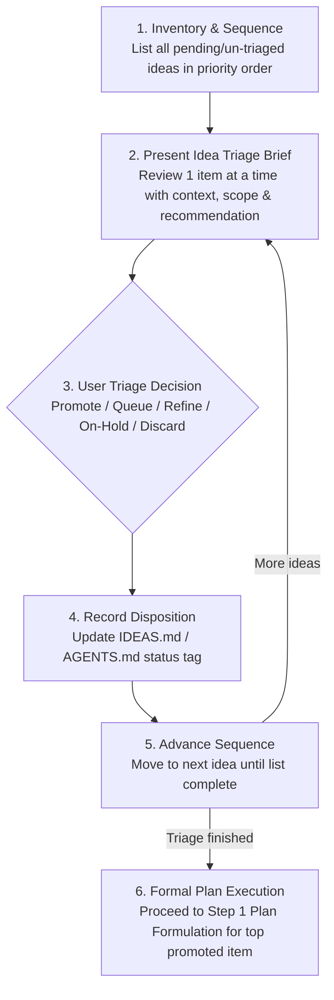

# Idea Triage Skill

This skill provides the operational workflow for converting informal items in `<project>/docs/plans/IDEAS.md` into structured, numbered implementation plans.

## 1. Backlog Entry Format in `IDEAS.md`
Users log ideas asynchronously in this format:
```markdown
### [FEATURE / BUG / REFACTOR] Short Title
- **Context**: 1-2 sentences explaining the motivation or observation.
- **Proposed Solution**: High-level behavior or architecture change.
- **Target Project / Component**: Subsystem affected.
- **Priority**: High / Medium / Low / P0–P9
```

## 2. Interactive Idea Triage Protocol

When the user asks to review, audit, or triage ideas ("go through them in order", "triage ideas", etc.), AI agents **MUST NOT** immediately begin authoring implementation code or drafting full 7-section plans. Instead, execute the structured **Interactive Triage Protocol**:



### Step 2.1: Inventory & Order Definition
1. Gather all active/un-triaged ideas across the target project(s) or root backlog (`docs/plans/IDEAS.md`).
2. Group them by category/tier and present the numbered sequence to the user.

### Step 2.2: Present Structured Triage Brief (One Idea at a Time)
For each idea in sequence, present a concise review brief containing:
- **Project & Title**: Subsystem and descriptive title.
- **Context & Problem**: Why this was logged and what problem it solves.
- **Technical & Architectural Scope**: Blast radius, affected subsystems, dependencies, hardware/service requirements.
- **Agent Recommendation**: Concrete opinion on priority, timing, and architectural placement.
- **Disposition Choices**:
  - `[PROMOTE]`: Ready for immediate implementation; assign next plan number and transition to Step 1 Formal Plan Formulation.
  - `[QUEUE]`: Approved high-priority plan; assign target plan number and add to `Prioritized Active Execution Queue` in `AGENTS.md`.
  - `[REFINE]`: Requires scoping adjustments, splitting into smaller phases, or clarification before planning.
  - `[ON-HOLD]`: Valid concept, but deferred pending external hardware, third-party dependency, or higher-priority milestone.
  - `[DISCARD / MERGE]`: Obsolete, low-value, duplicate, or already addressed by another module/plan.

### Step 2.3: Record Disposition & Advance
1. Await the user's explicit decision for the item.
2. Update the idea's status in `<project>/docs/plans/IDEAS.md` (e.g., `Status: Triaged (Queued for Plan NN)` or `Status: ON HOLD (Reason: ...)`).
3. If promoted or queued, register the assigned plan number in `<project>/docs/plans/AGENTS.md`.
4. Advance to the next item in the sequence.

---

## 3. Transition to Formal Planning (Step 1 of Plan Pipeline)
Once an idea has been triaged as `[PROMOTE]` and all items in the current triage batch have been reviewed (or the user instructs to proceed with the promoted item):
1. Allocate the next sequential plan number in `<project>/docs/plans/AGENTS.md`.
2. Formulate the formal 7-section plan (`<project>/docs/plans/NN_<feature>_plan.md`).
3. Follow the 5-step lifecycle per [`plan-pipeline skill`](../plan-pipeline/SKILL.md).

---

## 4. Mid-Plan Intake Disambiguation (Clean Commit History Guard)
If the user prompts to plan a new task while an active plan is currently in execution or validation:
1. **Do NOT** abandon or pause the active plan silently.
2. **Ask the user**:
   > *"We are currently in the middle of implementing Plan `<ID>`. Would you like me to add this new request as an idea in `<project>/docs/plans/IDEAS.md` (to preserve a clean commit history and finish the current plan first), or would you prefer to pause/switch and formulate it as a full-fledged plan right now?"*
3. If the user confirms idea intake, append it to `docs/plans/IDEAS.md` and resume the current plan.

