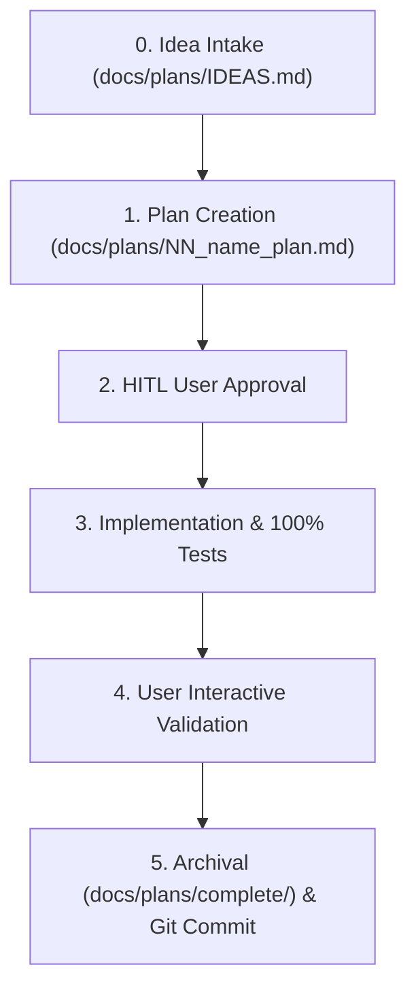

# Plan Pipeline Skill

This skill defines the mandatory feature development, bug-fix, and refactoring lifecycle across the workspace.

## 1. Directory Structure per Project
Each project maintains its own `docs/plans/` folder:
- `<project>/docs/plans/`: Active plans currently in formulation or execution.
- `<project>/docs/plans/AGENTS.md`: Master Plan Registry and execution queue for that project.
- `<project>/docs/plans/IDEAS.md`: Asynchronous idea and bug backlog for that project.
- `<project>/docs/plans/complete/`: Archived plans and walkthroughs prefixed with completion date: `YYYY-MM-DD-<plan_name>.md`.

## 2. Standardized 5-Step Lifecycle

### Step 1: Formal Plan Creation
Every plan must contain all 7 mandatory sections:
1. `# Plan NN: <Title>` (Numbered via the project's Master Registry in `<project>/docs/plans/AGENTS.md`).
2. `## 1. Goal Description`: Problem statement, context, and objectives.
3. `## 2. Architecture & Workflow Diagram`: Mermaid flowchart or sequence diagram.
4. `## 3. Code Modifications`: Component breakdown with `[NEW]`, `[MODIFY]`, `[DELETE]` file tags.
5. `## 4. Test Updates & Specifications`: Unit/integration test methods, assertion criteria, baseline regression assertions, and Red-Green bug reproduction tests.
6. `## 5. Documentation Updates`: Explicit files in `<project>/docs/` to update.
7. `## 6. Verification Plan`: Automated test commands and step-by-step manual verification.

### Step 2: Human-in-the-Loop (HITL) Sign-off
Present the plan to the user. Do NOT write code before user approval.

### Step 3: 3-Phase Test-First Implementation & Hermetic Verification
Execute in 3 strict phases:
1. **Phase 3.1: Pre-Code Test Harness (RED / Baseline)**:
   - Establish automated baseline tests verifying that existing behaviors work before making changes.
   - For bug fixes, write a failing reproduction test demonstrating the reported issue (RED).
   - Run `./run_tests.sh` to confirm baseline passes and bug test fails as expected.
2. **Phase 3.2: Minimal Blast Radius Implementation (GREEN)**:
   - Implement root-cause code modifications and documentation updates using native editing tools (`replace_file_content` / `write_to_file`).
   - Run `./run_tests.sh` to confirm the reproduction test passes cleanly (GREEN).
3. **Phase 3.3: Full Regression Retest & Coverage Verification**:
   - Run the project's hermetic test suite (`./run_tests.sh`). All tests must pass (100% pass rate).
   - Verify zero regressions against previously established baseline behaviors.

### Step 4: Interactive Validation
Instruct the user on how to verify the feature in the running UI or server. Await explicit user confirmation.

### Step 5: Archival, Coverage Ratchet Verification & Git Commit
1. **Coverage Scorecard & Ratchet Invariant Check**:
   - Run `./scripts/measure_coverage.sh` and `python3 scripts/evaluate_behavior_coverage.py` (when code or test files have been modified).
   - **Hard Rule**: Ensure statement/branch coverage and invariant verification counts have not regressed ("no plan will ever make those numbers worse").
   - Record updated metrics in the walkthrough document and append to the Historical Milestone Log in `docs/TEST_COVERAGE_METRICS.md`.
2. Archive the plan to `docs/plans/complete/YYYY-MM-DD-<plan_name>.md` and save `docs/plans/complete/YYYY-MM-DD-<plan_name>_walkthrough.md` (automated via `python3 scripts/plan_pipeline.py archive --plan <path>`).
3. Update Master Registry in `docs/plans/AGENTS.md` to `ARCHIVED` and remove the completed item from the active queue.
4. Stage and commit all files to Git.

## 3. Questions vs. Action Directives (Execution Boundary & Mandatory Plan Gate)
- **Questions**: When the user asks a question (e.g. asking for explanations, architectural possibilities, or exploratory trade-offs), do **NOT** assume immediate execution or modify files, even if in accept-edits mode. Provide thorough analysis and await user instructions.
- **Action Directives & Mandatory Plan Pipeline Gate**: When the user explicitly instructs the agent to implement an option or fix a bug (e.g. "Implement Option A", "Let's start with 2 and 3"):
  1. If the directive modifies application code, schemas, templates, or tests in a component that does **not** yet have an approved plan covering that change, "proceeding immediately" means **entering Step 1 of the Plan Pipeline (authoring and presenting the formal 7-section plan in `<project>/docs/plans/NN_<name>_plan.md` for Step 2 HITL approval)** — NEVER bypassing Step 1 & Step 2 to edit application code directly.
  2. Direct execution without authoring a new plan is permitted ONLY for Step 3 of an already-approved plan, Step 4 tweaks to an active open plan, or operational/diagnostic commands.

## 4. Minimal Blast Radius & Root-Cause Standard
- **Root-Cause Resolution**: Always investigate deeply to diagnose and fix the fundamental root cause of an issue rather than patching symptoms or applying superficial workarounds.
- **Minimal Blast Radius**: Keep all code modifications, refactors, and configuration changes tightly scoped, small, and high-leverage. Avoid unbounded, sprawling changes when a concise, well-targeted modification solves the root issue cleanly.

## 5. System & Data Safety Invariant (Command Transparency & Impact Assessment)
- **Safety First**: Prioritize the safety, stability, and integrity of the user's system, databases, and network at all times.
- **Pre-Execution Explanation**: Before executing commands that modify the filesystem, delete files, alter firewall rules, restart services, or mutate database state, explain **what** the command does, **why** it is necessary, and **what the potential impact** is.

## 6. Native Edit Tool Invariant (Zero Shell Cat File Modifications)
- **Tool Selection**: Assistants MUST ALWAYS use the native file editing tools (`replace_file_content` / `write_to_file`) for creating and modifying files. Never use shell commands like `cat << 'EOF' > ...` or bash stream redirection, as shell writes trigger manual user confirmation prompts on every edit.

## 7. Standardized Pre-Approved Script Matrix
- Use standardized scripts for routine operations:
  - `./run_tests.sh` (or `scripts/run_all_tests.sh`): Hermetic test execution across projects.
  - `./fetch_logs.sh` (or `scripts/fetch_all_logs.sh`): Remote error log harvesting for AI triage.
  - `./deploy.sh --dry-run`: Pre-deployment preview without modifying remote state.
  - `python3 scripts/plan_pipeline.py status | validate | new | archive`: Automated plan pipeline inspection, 7-section/link validation, scaffolding, and Step 5 archival.

## 8. Universal Test-First & Red-Green Regression Gating Protocol
- **Pre-Implementation & Post-Implementation Regression Gating**: Any affected code MUST always be validated with automated tests before and after modifications to guarantee zero regressions.
- **Bug Reproduction & Fix Verification (Red-Green-Refactor)**: All bug fixes MUST include a before-and-after test demonstrating the bug failing before the patch (RED) and passing cleanly after the patch (GREEN).
- **Refactor Baseline Coverage**: Before any module or subsystem is refactored, automated baseline test coverage must be established and verified at 100% pass rate before modifying application code.

## 9. Mid-Plan Planning Request Disambiguation Protocol (Clean Commit History Guard)
- **Mid-Execution Planning Directives**: If an active plan is currently in implementation or interactive validation (Step 3 or Step 4), and the user prompts to plan a new task (e.g. via `/plan ...` or an informal request), the agent **MUST NOT** immediately stop the current plan, author a new plan in place, or pollute uncommitted working trees.
- **Disambiguation Query**: Ask the user:
  > *"We are currently in the middle of implementing Plan `<ID>`. Would you like me to add this new request as an idea in `<project>/docs/plans/IDEAS.md` (to preserve a clean commit history and complete the current plan first), or would you prefer to pause/switch and formulate it as a full-fledged plan right now?"*

## 10. Tiered Test Execution & Coverage Measurement Efficiency
- **Code vs. Documentation Gate**: Automated test execution is only required when executable application code, scripts, or runtime configurations change. Pure documentation, guide, or plan text changes skip test runs.
- **Coverage Measurement Gate**: If no application code and no test files were modified, test coverage cannot mathematically change. Re-running `./scripts/measure_coverage.sh` during Step 5 closeout is skipped.
- **Project-Isolated Testing**: Executing a plan against a specific sub-project only requires running that project's hermetic test runner (`./run_tests.sh`). It is not required to re-run the workspace-wide master suite (`./scripts/run_all_tests.sh`) unless $> 1\text{ week}$ has elapsed since the last full workspace run or when cross-project orchestration scripts in `scripts/` or root `tests/` are modified.

## 11. Unrelated Test Failure Handling Protocol (Fail-Fast & Defer)
- **Strict Scope Boundary**: If an existing test fails during plan execution that is completely unrelated to the active plan's declared scope or modified files, AI agents **MUST NOT** expand the plan scope or perform ad-hoc fixes during that turn.
- **Protocol**:
  1. Log the failure clearly in the test output.
  2. Notify the user of the failing unrelated test and its diagnostic signature.
  3. Open a dedicated triage entry in `<project>/docs/plans/IDEAS.md` for subsequent planning, prioritization, and resolution.

## 12. Cross-Subsystem Plan Coupling & Component Isolation Protocol
- **Hard Invariant**: **No changes are ever made to a component without a dedicated, documented plan authored for that specific component.**
- **Strict Blast Radius & Project Boundary**: If a feature, integration, or diagnostic capability requires modifications across multiple sub-projects:
  1. AI agents **MUST NOT** modify files in `Subsystem B` under a plan authored solely for `Subsystem A`.
  2. The originating plan in `Subsystem A` must constrain its declared scope, code edits, and tests strictly to `Subsystem A`.
  3. A dedicated, paired plan must be authored and approved in `Subsystem B`'s own `docs/plans/` directory (`<subsystem_b>/docs/plans/NN_<feature>_plan.md`) before any code, schema, template, or test in `Subsystem B` is modified.
  4. For multi-node or architecture-spanning initiatives, a **Root Macro Plan (`docs/plans/MNN_<name>_plan.md`)** must be established to govern the overall epic and coordinate both child sub-plans.
