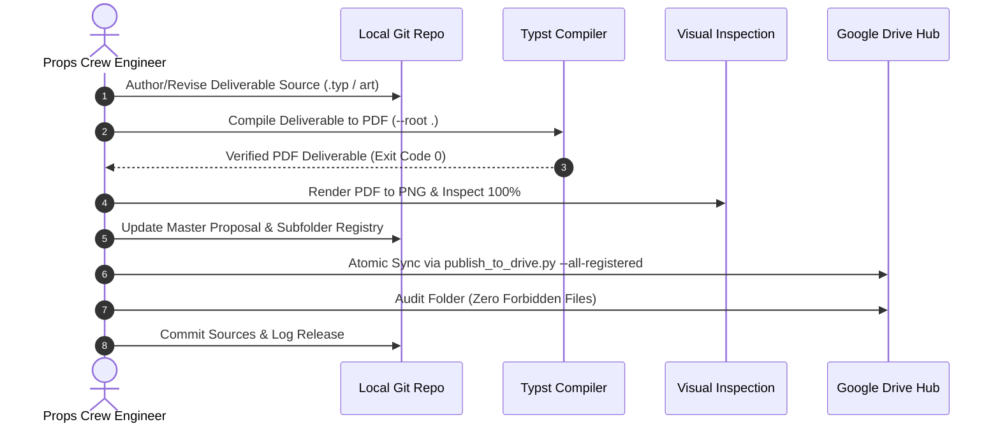

# PCHSMB Concept Planning Distribution Hub — Publication Skill & Workflow Standard

This skill codifies the mandatory procedure for publishing client-facing documents, visual production photography, engineering trade studies, and executive decision packets to band leadership and booster coordinators via the shared Google Drive directory.

---

## 1. Distribution Purpose & Shared Directory Path

The shared distribution folder serves as the official, external client-facing portal for Pine Creek High School Marching Band leadership:
- **Band Directors & Associate Directors:** Show design concepts, prop feasibility, rehearsal and competition logistics.
- **Visual Coordinators & Show Designers:** Visual pacing, prop sizing, lighting choreography, aesthetic decision briefs.
- **Booster Club Executive Board & Treasurers:** Fabrication budget menus, capital investment trade studies, BOM pricing.
- **Parent Crew Leads:** Construction hours, shop tooling, truck packing logistics, field ingress/egress safety.

### Authoritative Distribution Path
$$\mathbf{\sim/Library/CloudStorage/GoogleDrive\text{-}<account>/My\ Drive/PCHSMB\ Concept\ Planning/}$$

---

## 2. Core Invariants (Non-Negotiable)

```mermaid
flowchart LR
    subgraph GitRepo["Git Repository (Master Source of Truth)"]
        direction TB
        TypSrc["Typst Sources (.typ)"]
        ArtSrc["Design Renders (.png/.jpg)"]
        Reg["Technical Reports Registry"]
        PropTyp["Master Proposal Source (00_...typ)"]
    end

    subgraph QAGates["Verification &amp; QA Gates"]
        direction TB
        Comp["Headless Compilation (Zero Errors)"]
        VisQA["Visual QA (Render to PNG &amp; Inspect 100%)"]
        Audit["Strict Extension &amp; Layout Audit"]
    end

    subgraph GoogleDrive["Shared Google Drive (Organized Distribution Hub)"]
        direction TB
        MasterPDF["00_PCHSMB_2027_Prop_Ecosystem_Executive_Menu_and_Proposal.pdf"]
        Sub01["01_Fleet_Maintenance/ (5 Reference PDFs)"]
        Sub02["02_Field_Lighting_Platform/ (4 Platform PDFs)"]
        Sub03["03_Kinetics_and_Mechanical_Effects/ (2 Kinetic PDFs)"]
        Sub04["04_Prop_Concepts_and_Centerpieces/ (4 Concept PDFs)"]
        SubImages["images/ (22 Renders + AI Disclaimer)"]
        Lock["STRICTLY NO SOURCE FILES<br/>(No .typ, .docx, .md, .py, .kicad)"]
    end

    GitRepo --> QAGates
    QAGates --> GoogleDrive
```



### Invariant 1: Strictly PDF, Image, and Readme Deliverables Only
- **PERMITTED FORMATS:** `.pdf`, `.png`, `.jpg`, `.jpeg`, and documentation `README.md` in asset galleries.
- **FORBIDDEN FORMATS:** Absolutely **NO** editable raw engineering files (`.typ`, `.docx`, `.py`, `.c`, `.kicad_*`, `.fcstd`, `.afdesign`, `.csv`, `.sh`, `.json`).
- **Rationale:** Band directors and booster parents open files on smartphones, tablets, and personal laptops without specialized IDEs, fonts, or CAD tools. Every distributed deliverable must render identically with zero software prerequisites.

### Invariant 2: Repository as Single Authoritative Source of Truth
- The master Git repository (`PCHSMB/`) remains the sole authoritative design environment.
- Files placed into the Google Drive directory are **downstream distribution copies** of versioned repository assets. Never author, edit, or modify files directly within the Google Drive directory.

### Invariant 3: Master Deliverable & Subfolder Architecture
- The Google Drive root contains **only** the primary client-facing proposal and the visual gallery:
  - `00_PCHSMB_2027_Prop_Ecosystem_Executive_Menu_and_Proposal.pdf` (Master À La Carte Proposal)
  - `images/` (Visual Concept Gallery)
- Detailed background documentation, engineering analyses, trade studies, and component manuals reside in organized reference subfolders:
  - `01_Fleet_Maintenance/`
  - `02_Field_Lighting_Platform/`
  - `03_Kinetics_and_Mechanical_Effects/`
  - `04_Prop_Concepts_and_Centerpieces/`

### Invariant 4: Formal Document ID & Technical Reports Registration
- Every formal technical analysis, trade study, or system specification published to the folder must carry an authorized Document ID from `PCHSMB/TECHNICAL_REPORTS_REGISTRY.md` (e.g. `TS-SYN-2026-01`, `TR-FLG-2026-01`, `TR-FLG-2026-02`, `PROP-OPS-2026-01`).
- Numbers must never be fabricated, duplicated, or skipped.

---

## 3. End-to-End Publication Workflow



### Phase 1: Source Authoring & Document ID Allocation
1. Author the deliverable in its appropriate subproject directory (e.g. `PCHSMB/_Lighting Controller/docs/`, `PCHSMB/Experiments/<Concept>/decision_briefs/`, or `PCHSMB/docs/`).
2. If the document is a formal trade study, specification, or technical report:
   - Check `PCHSMB/TECHNICAL_REPORTS_REGISTRY.md`.
   - Allocate the next sequential Document ID.
   - Embed the Document ID in the running footer and title block.

### Phase 2: Compilation & Zero-Warning Gate
Compile the deliverable from the workspace root using Typst:
```bash
typst compile --root . "PCHSMB/docs/00_PCHSMB_2027_Prop_Ecosystem_Executive_Menu_and_Proposal.typ" "PCHSMB/docs/00_PCHSMB_2027_Prop_Ecosystem_Executive_Menu_and_Proposal.pdf"
```
- Compilation must exit with code `0`.
- All font substitutions, unresolved references, and layout warnings must be zero.

### Phase 3: Visual Inspection & Layout QA
Before publishing, render the deliverable to PNG and inspect layout, margins, pagination, and color balance:
```bash
typst compile --root . --format png --ppi 144 "PCHSMB/docs/00_PCHSMB_2027_Prop_Ecosystem_Executive_Menu_and_Proposal.typ" "scratch/proposal_page_{0p}_of_{t}.png"
```
- Verify headers and footers contain the required confidentiality notices and page counters (`Page X of Y`).
- Confirm figures and tables adhere to the Props Crew branding standard (`PCHSMB/Graphics/Props Crew Docs Logo Horizontal.svg`).

### Phase 4: Automated Distribution Copy & Audit
Execute publication using the authoritative helper script:
```bash
python3 .agents/skills/publish-concept-planning/scripts/publish_to_drive.py --all-registered
```

The script automatically executes:
1. Destination folder accessibility checks.
2. Extension validation (`.pdf`, `.png`, `.jpg`, `.jpeg`, `.md` only).
3. Checksum verification (SHA-256) on all copied files.
4. Recursive folder audit ensuring zero forbidden files exist anywhere in the distribution tree.

---

## 4. Current Distribution Inventory

The Google Drive directory is structured into an executive root and four reference subfolders:

### Root Level
- `00_PCHSMB_2027_Prop_Ecosystem_Executive_Menu_and_Proposal.pdf` (Master 4-page client-facing proposal)

### Subfolder: `01_Fleet_Maintenance/`
- `Backdrop_Assembly_Guide.pdf` (Full 28-page assembly and operations manual)
- `Backdrop_Wind_Vent_Options_Flyer.pdf` (Semicircular wind relief flap engineering flyer)
- `Sideline_Screen_Duck_Blind_Build_Instructions.pdf` (Full 25-page fabrication and operations manual)
- `Sideline_Screen_Wind_Vent_Options_Flyer.pdf` (Sideline screen wind relief flap flyer)
- `Stage_Platform_Build_Instructions.pdf` (Performance stage and staircase manual)

### Subfolder: `02_Field_Lighting_Platform/`
- `Synapse_System_Sales_Brochure.pdf` (4-page color introductory brochure)
- `TS-SYN-2026-01_Synapse_vs_Commercial_Trade_Study.pdf` (Technical Report `TS-SYN-2026-01`: Synapse vs Commercial & Manual Control)
- `Lighting_Controller_Pilot_Build_BOM.pdf` (1 Synapse + 3 Prop Nodes pilot procurement specification)
- `Carrier_Board_BOM_Purchasing_Guide.pdf` (Full fleet 30-prop carrier board sourcing schedule)
- `TR-SYN-2026-02_Show_and_Lighting_Synchronization_Analysis.pdf` (Dynamic live tempo synchronization analysis)
- `TR-SYN-2026-03_Multi_Controller_RF_Coordination_and_Auxiliary_Console_Analysis.pdf` (Multi-controller coordination study)
- `TR-SYN-2026-04_Rehearsal_Power_and_Integrated_Charging_Analysis.pdf` (Rehearsal power and onboard charging analysis)
- `TS-SYN-2026-05_Field_Prop_Battery_Architectures_Trade_Study.pdf` (Battery architectures and DC distribution trade study)
- `TS-SYN-2026-06_Front_Ensemble_Control_Interfaces_Trade_Study.pdf` (Front ensemble control interfaces trade study)
- `TR-SYN-2026-08_Lighting_System_Comprehensive_Risk_Analysis.pdf` (Comprehensive risk, volunteer scalability & storage analysis)

### Subfolder: `03_Kinetics_and_Mechanical_Effects/`
- `FLAG_THROWER_EXECUTIVE_PROPOSAL.pdf` (Technical Proposal `TR-FLG-2026-02`: 10-ft baseline mechanical spring thrower)
- `FLAG_THROWER_20FT_EXECUTIVE_PROPOSAL.pdf` (Technical Proposal `TR-FLG-2026-01`: 20-ft extended 2:1 Dyneema thrower)
- `TR-KIN-2026-01_Kinetic_Props_Comprehensive_Risk_Analysis.pdf` (Technical Report `TR-KIN-2026-01`: Comprehensive tooling, fabrication, optical sourcing, hybrid controls & storage analysis)

### Subfolder: `04_Prop_Concepts_and_Centerpieces/`
- `PCHSMB_2027_Field_Beacon_Decision_Packet.pdf` (12-page full production brief evaluating 10 show concepts)
- `BEACON_COST_OPTIONS_ONE_PAGER.pdf` (1-page executive budget menu)
- `PCHSMB_2027_Field_Lantern_Decision_Packet.pdf` (6-page handheld field lantern evaluation)
- `PCHSMB_2027_Field_LGO_Decision_Packet.pdf` (6-page Large Glowing Objects centerpiece trade study)

### Subfolder: `images/`
- `README.md` & `README.pdf` (AI Conceptual Visualization Disclaimers)
- 22 high-resolution production concept renders (Concept 1 through Concept 10 + variants)
