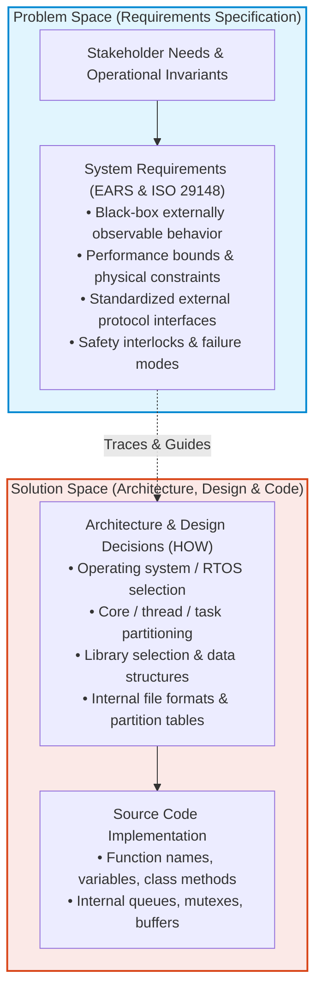

# Requirements Engineering & Specification Standard

This skill establishes the universal engineering principles, syntax rules, and inspection protocols for authoring, reviewing, and refactoring requirements across all projects in the workspace.

---

## 1. The Fundamental Principle: Problem Space vs. Solution Space

A frequent and damaging engineering antipattern is confusing **System Requirements ("WHAT" the system must accomplish)** with **Implementation Details & Design Decisions ("HOW" internal software, libraries, tasks, or file structures realize those requirements)**.

### Why Implementation Leakage Damaged Requirements
1. **Artificially Constrains Architecture**: Dictating an internal implementation (e.g., *"The system shall run a FreeRTOS task on Core 0 named `bleWorkerTask`"*) prevents developers from choosing more efficient, modern, or portable alternatives (e.g. an asynchronous event loop or bare-metal scheduler).
2. **Obscures True Stakeholder Needs**: Internal code details distract from what the user or system actually needs to achieve (e.g., non-blocking concurrent telemetry ingestion with guaranteed radio availability).
3. **Invalidates Black-Box Verification**: When a requirement mandates an internal function or variable, black-box verification becomes impossible without white-box code coupling.
4. **Causes Premature Obsolescence**: When refactoring code, internal variable or task names change, rendering the requirements document outdated or invalid even though system behavior is unchanged.

---

## 2. The INCOSE Solution-Free Heuristics

According to the **INCOSE Guide to Writing Requirements (GtWR)**, requirements must be **solution-free** unless an external constraint strictly dictates otherwise.

Use these two mental tests on every requirement statement:

### The "Why?" Test
When reviewing a requirement that specifies a technology, library, or internal mechanism:
- *Statement*: *"The gateway shall use FreeRTOS Core 0 to poll BLE."*
- *Ask*: *"Why?"*
- *Answer*: *"Because concurrent Wi-Fi network transmission on the same chip causes radio packet loss if Bluetooth scanning is interrupted."*
- *Refactored Requirement*: *"The gateway shall process incoming BLE advertisements and GATT sessions concurrently with Wi-Fi network transmission without dropping radio frames."*

### The "Alternative Design" Test
- *Ask*: *"Could an alternative technical design satisfy the stakeholder's true need?"*
- If the answer is *yes*, then the statement is an **implementation detail** that belongs in `ARCHITECTURE.md` or source code docstrings, NOT in `REQUIREMENTS.md`.

---

## 3. Distinguishing Real Constraints from Implementation Details

Not all technical nouns are implementation details. Systems engineering distinguishes between **True External Constraints** and **Internal Design Choices**:

| Category | Definition | Examples (Valid Requirements) | Examples (Invalid Implementation Leakage) |
| :--- | :--- | :--- | :--- |
| **External Interface** | Standards mandated by third-party systems outside our control. | SAE J1962 OBD-II pinout, ISO 15765-4 CAN 11-bit 500k protocol, BLE 4.2 Core Spec, REST HTTP JSON schema. | Internal C++ class names, function signatures, `std::vector::reserve()`. |
| **Physical / Environmental** | Real-world physical conditions that dictate operational viability. | Operating temperature $-10^\circ\text{C}$ to $55^\circ\text{C}$, utility power $5.0\,\text{V} \pm 0.25\,\text{V}$, quiescent sleep draw $< 3.0\,\text{mA}$. | Specific manufacturer wall charger model, brand of USB cable. |
| **Safety Invariant** | Non-negotiable limits protecting life, equipment, or vehicle batteries. | Hard disconnect within $T \le 60.0\,\text{s}$, immediate disconnect if voltage $< 13.0\,\text{V}$. | Use of a FreeRTOS software timer vs hardware timer interrupt. |
| **Internal Software Design** | How the engineering team chooses to build the software. | **None** (belong in architecture). | FreeRTOS task names, NimBLE library, LittleFS filenames (`/spool.jsonl`), partition table names (`min_spiffs.csv`). |

---

## 4. ISO/IEC/IEEE 29148 Quality Characteristics

Every requirement statement in any project specification MUST satisfy the 9 ISO 29148 quality criteria:

1. **Implementation-Free (Solution-Independent)**: Specifies the desired external behavior without dictating internal design.
2. **Necessary**: Represents a true stakeholder requirement, interface standard, or safety boundary.
3. **Unambiguous**: Has exactly one plausible interpretation to all readers.
4. **Consistent**: Does not contradict any other requirement in the specification.
5. **Complete**: States all applicable conditions, inputs, triggers, and quantified tolerances.
6. **Singular (Atomic)**: Expresses one and only one requirement (avoid compound sentences joined by "and also").
7. **Feasible**: Technically achievable within physical laws and constraints.
8. **Traceable**: Assigned a globally unique, immutable ID (e.g. `REQ-DOM-NN`) mapped in a Requirements Traceability Matrix (RTM).
9. **Verifiable (Testable)**: Can be verified definitively using one of the four formal verification methods:
   - **Test (T)**: Automated execution against quantitative pass/fail assertions.
   - **Demonstration (D)**: Operational observation of functional behavior under real conditions.
   - **Inspection (I)**: Visual or manual verification of physical hardware, schematics, or CAD geometry.
   - **Analysis (A)**: Engineering calculations, simulations, or mathematical proofs.

---

## 5. EARS Syntax Patterns (Easy Approach to Requirements Syntax)

To eliminate ambiguity, passive voice, and compound sprawl, all requirements MUST follow one of the 5 standard **EARS (Easy Approach to Requirements Syntax)** patterns:

### 1. Ubiquitous Pattern (Always Active)
Used for continuous invariants, fundamental capabilities, or physical qualities:
> **The `<system name>` shall `<system response>`.**
- *Example*: `The gateway shall continuously measure ambient 12V battery voltage with an accuracy of ±0.05 V.`

### 2. State-Driven Pattern (Active During a State)
Used when a behavior is conditioned on a continuous operational state:
> **While `<precondition / operational state>`, the `<system name>` shall `<system response>`.**
- *Example*: `While connected to an in-vehicle OBD transceiver, the gateway shall limit the active diagnostic session to a maximum duration of 60.0 seconds.`

### 3. Event-Driven Pattern (Triggered by an Event)
Used when an external or internal event triggers a specific response:
> **When `<trigger event occurs>`, the `<system name>` shall `<system response>`.**
- *Example*: `When vehicle battery voltage drops below 11.9 V for three consecutive readings, the system shall generate a low-voltage battery alert.`

### 4. Unwanted Behavior / Error Handling Pattern
Used to specify behavior under error conditions, sensor faults, or communications drops:
> **If `<unwanted condition / error occurs>`, then the `<system name>` shall `<system response>`.**
- *Example*: `If network connectivity to the central server is lost, then the gateway shall buffer all incoming telemetry records in non-volatile storage without data loss.`

### 5. Complex Pattern (State + Event)
Used when an event occurs within a specific operational state:
> **While `<operational state>`, when `<trigger event occurs>`, the `<system name>` shall `<system response>`.**
- *Example*: `While in the parked resting state, when battery voltage increases above 13.0 V, the gateway shall initiate an active arrival telemetry sweep.`

---

## 6. The Requirements Authoring Checklist & Linter

Before submitting or approving any requirements specification (`REQUIREMENTS.md`), audit every requirement against this checklist:

- [ ] **No Code Symbols**: Contains zero mentions of programming language symbols (e.g. `bleWorkerTask`, `xSemaphore`, `std::vector`, `struct`, `class`).
- [ ] **No Internal Software Library Names**: Does not mandate specific software libraries (e.g. `NimBLEScan`, `ArduinoJson`, `pandas`, `requests`) unless mandated as an immutable third-party protocol standard.
- [ ] **No Internal File Paths or Partition Layouts**: Does not mandate internal implementation filenames (e.g. `/spool.jsonl`, `min_spiffs.csv`, `main.cpp`).
- [ ] **Strict EARS Syntax**: Begins with standard EARS clauses (*The system shall...*, *When...*, *While...*, *If... then...*).
- [ ] **Quantified Acceptance Criteria**: Every performance or timing requirement specifies an exact numerical threshold and tolerance (e.g. `$T \le 60.0\,\text{s}$`, `$\pm 0.05\,\text{V}$`, `$\ge 1,000$ records`).
- [ ] **Definitive Verification Method**: Assigned a specific verification method (`UT`, `IT`, `HIL`, `SA`) and mapped to an automated test or bench protocol in the Requirements Traceability Matrix.
