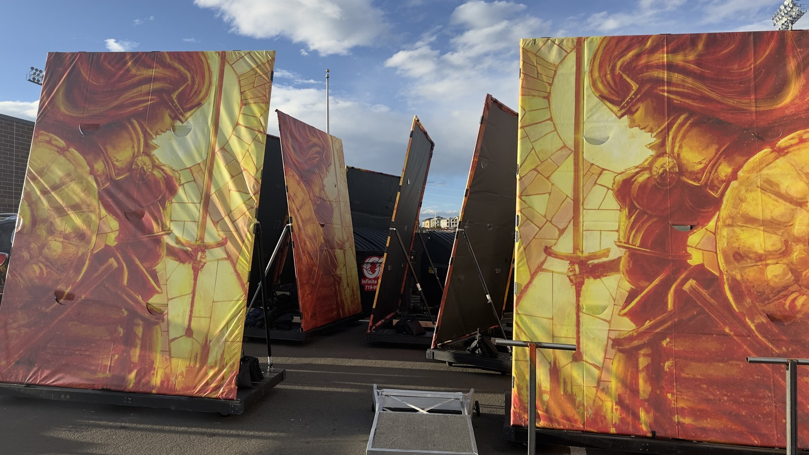

# Rolling Backdrop System

The **Rolling Backdrop System** is a modular, mobile field prop developed for the Pine Creek High School Marching Band (PCHSMB). It provides a nominal 10 ft high x 8 ft wide visual display surface mounted on a dedicated, heavy-duty rolling wood cart base for rapid entry, positioning, and exit during competitive field show performances.

> **Design Credit:** Special thanks and credit to the **Plainfield North Bands** for creating the original cart design and foundational engineering concept, which has been adapted and refined here for the Pine Creek High School Marching Band.

---

## 📖 Build & Operations Manual

The authoritative, fully illustrated manual is maintained in the [`docs/`](docs/) directory:

👉 **[View Complete Manual (PDF)](docs/Backdrop_Assembly_Guide.pdf)** *(Release v0 (D9) — 28 Pages)*  
📄 **[Typst Master Source](docs/Backdrop_Assembly_Guide.typ)** | 📋 **[Project Manifest](docs/project.json)**

The manual uses a standardized cross-project appendix architecture harmonized with the [Sideline Screen Manual](../_Sideline%20Screen/docs/Sideline_Screen_Duck_Blind_Build_Instructions.pdf):
- **Master Cover & Preamble (Pages 1–2):** Prop identity, structural architecture, visible version history (Build D9), and master manual organization.
- **Appendix A: Field Operations Manual (Sections 1.1–1.7):**
  - **1.1 Roles & Responsibilities:** Parent pit/logistics crew vs student prop handlers (2–4 students per backdrop cart; 22–44 students for 11-prop fleet).
  - **1.2 Staging, Transport & Field Gate Entry:** Backfield staging and CBA Rule 5.02 rear entrance mandate.
  - **1.3 Field Deployment Protocol:** Synchronized placement and opening drill set transitions.
  - **1.4 Post-Performance Retrieval & Continuous Exit:** 2-minute CBA egress routing through front-half end zone.
  - **1.5 Ballasting System & Tiered Wind Safety:** Tier 0 (calm) through Tier 4 (>20 mph NO-GO abort), synthetic turf friction ($16.9\text{ mph}$ Tier 1, $22.3\text{ mph}$ Tier 3 via 3.46-ft rear-rail leverage optimization), and Rule 8.05 double-bagging.
  - **1.6 2026 CBA Competition Rules:** Rules 4.02, 4.03/5.06, 5.02, 8.05, 8.07, 8.08, 8.09 (Falcon Stadium renovation clearance), and 9.07 (25 field wristbands).
  - **1.7 Post-Use Teardown & Trailer Packout:** Deballasting, frame breakdown, and transport securing.
- **Appendix B: Construction & Fabrication Manual (Sections 2.1–2.10):**
  - **2.1–2.4:** Shop safety, materials BOM, tools/equipment, and 3D printed parts.
  - **2.5 Raw Material Cutting Schedules:** 2x4 lumber framing schedule and 1-5/8" galvanized steel conduit cuts.
  - **2.6 Estimated Fabrication Cost Breakdown:** Detailed per-prop itemized budget (~$416.00 complete chassis base).
  - **2.7 Step-by-Step Frame Assembly:** Stage 1 (Base Cart), Stage 2 (Decking, Casters & Posts), Stage 3 (Steel Upright Frame with 60″ Mid Rail & 6-4 Pop Rivets), and Stage 4 (Diagonal Struts).
  - **2.8 Mechanical Inspection & QA Protocol:** Acceptance criteria table and formal sign-off sheet.
  - **2.9 Vinyl Banner Installation:** Ordering bleed, tensioning/clamping procedure, Section 2.9.3 dedicated **Semicircular Wind Relief Flap Cutting** ($R = 4.0\text{ in.}$, $8.0\text{ in.} \times 4.0\text{ in.}$, 8-flap 3-2-3 staggered quincunx straddling 60″ rail, Option 2 paint can, and 6-flap minimal variant, 3/8" punch holes, and [PCHSMB Field Prop Circle Cutter](../Circle%20Cutter/) tooling), and seasonal teardown.
  - **2.10 Appendix B Index & Purchasing References:** Vendor links, CAD part repositories, and governing rule citations.
- **Appendix C & C.1:** On-prop laminated field operations placard & 4" × 6" drill placement card template.
- **Appendix D:** Parent volunteer competition day guide & checklist.

---

## 🛠️ 3D Printed Parts & Fabrication Jigs

All 3D-printed parts should be printed in **Black ASA** (or UV/heat-stable PETG) for outdoor durability.

| Component / Tool | CAD Source / File | Purpose |
|---|---|---|
| **Corner Bumper Braces** | [`Hardware/Corner Brace.FCStd`](Hardware/Corner%20Brace.FCStd) | 4 required per cart; protects wood and paint from transport scuffs |
| **Drill Alignment Jig** | [`Hardware/Drill Alignment Jig.3mf`](Hardware/Drill%20Alignment%20Jig.3mf) | Clamps onto 1-5/8" fence pipe to guide 1/8" pilot holes for end caps |
| **Strut Bracket Marker** | [`Hardware/Steel Support Strut Bracket Marker.FCStd`](Hardware/Steel%20Support%20Strut%20Bracket%20Marker.FCStd) | Templates mounting positions for base U-bolts and upper tension bands |
| **PCHSMB Field Prop Circle Cutter** | [`PCHSMB/Circle Cutter/`](../Circle%20Cutter/) | Parametric 5-piece cutter with #11 blade and 608 bearings for $R=4.0"$ semicircular flaps |

---

## 📐 Materials Overview (Per Backdrop)

- **2x** 2x4 x 8-ft SPF/Doug Fir Lumber (Outer Rails A — 96.0")
- **2x** 2x4 x 8-ft Lumber (End Rails B — 44.5")
- **2x** 2x4 Lumber (Inner Longitudinal Rails C)
- **6x** 2x4 Lumber (Transverse Cross Joists D)
- **2x** 1/2-in. Plywood Decking Panels (Left & Right Wings)
- **2x** [3/4" Black Iron Floor Flanges](https://www.homedepot.com/p/The-Plumber-s-Choice-3-4-in-Black-Malleable-Iron-Floor-Flange-5-Pack-FBNF034-5/308967916)
- **2x** 3/4" Dia. x 18" Black Iron Threaded Pipe (Ballast Retention Posts)
- **8x** 1/4-20 x 1-1/2" Carriage Bolts, Washers & Lock Nuts (Flange Fasteners)
- **4x** [Heavy-Duty Swivel Casters with Brakes](https://www.amazon.com/dp/B0CPXFJCJL)
- **4–9x** [Abccanopy 15-lb Heavy-Duty Sandbags with Handle](https://www.amazon.com/dp/B0DFVVZDVK) (Wing Ballast — 4–6 bags Tier 1–2, 9 bags Tier 3)
- **4–9x** [Plastic Sandbag Liner Bags](https://www.amazon.com/dp/B0BG3F5XVS) (Mandatory Double-Bagging Compliance)
- **1–2x** [Sakrete 70-lb Traction Tube Sand](https://www.lowes.com/pd/Sakrete-0-07-cu-ft-70-lb-Traction-Sand/5015728687) + Contractor Bags (High-Wind Reserve)
- **2x** [1-5/8" Dia. x 10' 16-Ga. Steel Fence Line Posts](https://www.homedepot.com/p/Everbilt-1-5-8-in-Dia-x-8-ft-16-Gauge-Galvanized-Steel-Chain-Link-Fence-Line-Post-328923DPTSEB/312373067) (Vertical Uprights)
- **3x** 1-5/8" Dia. x 8' Steel Fence Top Rails (Top Rail, 60" Mid Cross Rail, and Bottom Rail)
- **1x** 1-5/8" Dia. x 10' 6" Steel Fence Top Rail (Cut into two 62.0" diagonal support struts)
- **4x** [1-5/8" 3-Way Clamp Corner Elbow Brackets](https://www.amazon.com/dp/B0CD7QT6L6)
- **2x** [1-5/8" T-Clamp Brackets](https://www.amazon.com/dp/B0B68L8T76) (Mid-Rail Support)
- **4x** [6-4 All-Steel Pop Rivets](https://www.amazon.com/dp/B07FCRN2N4?ref=ppx_yo2ov_dt_b_fed_asin_title&th=1) (1/4" grip, 3/16" dia., for T-bracket positional locking)
- **1x** [#11 HSS Drill Bit](https://www.amazon.com/dp/B00FXH81Y2?ref=ppx_yo2ov_dt_b_fed_asin_title) (0.1910" dia. for rivet pilot holes)
- **2x** [1-5/8" Galvanized Steel Tension Bands](https://www.homedepot.com/p/Everbilt-1-5-8-in-Galvanized-Steel-Chain-Link-Fence-Tension-Band-328521EB/312373099)
- **2x** [Heavy-Duty Steel U-Bolts](https://www.amazon.com/dp/B09L41JFMS)
- **14x** [1-5/8" Pipe Snap Clamps](https://www.amazon.com/dp/B0CDZP8YVF)
- **1x** [GRK #9 x 2-1/2" Star-Drive Wood Screws](https://www.homedepot.com/p/GRK-Fasteners-9-x-2-1-2-in-Star-Drive-Torx-Bugle-Head-R4-Multi-Purpose-Wood-Screw-300-Pack-100101/203533402)
- **1x** [GRK #10 x 4" Star-Drive Structural Screws](https://www.homedepot.com/p/GRK-Fasteners-10-x-4-in-R4-Self-Countersinking-Flat-Head-Multi-Purpose-Screw-50-per-Pack-103141/203525231)
- **1x** 1/8" HSS / Cobalt drill bit rated for steel
- **1x** 3/8" (10 mm) Rotary Leather Punch or Gasket Punch (Mandatory for cutting tear-arrest relief holes on banner flaps)

---

## 💨 Engineered Semicircular Wind Relief Cuts

All 11 rolling backdrop banners incorporate engineered **true semicircular wind relief cuts** to bleed dynamic wind shear, suppress destructive vortex flutter, and improve field stability:

- **Geometry:** True semicircle of radius $R = 4.0\text{ in.}$ ($8.0\text{ in.}$ wide top chord × $4.0\text{ in.}$ downward drop arc).
- **Rationale for Semicircular (vs. Oval):** Eliminates thermal tip sagging and curling, guarantees invisible appearance from stadium stands under calm air, uses a single radius for simple volunteer shop fabrication, provides clean $180^\circ$ tangency to tear-arrest holes, and unifies tooling across the entire PCHSMB prop fleet (sharing identical templates with the 16 Sideline Screens).
- **Fleet Primary Standard (Option 1):** 8 flaps arranged in a 3-2-3 staggered quincunx pattern straddling the 60″ mid cross rail ($Y = 96.0\text{ in.}$, $74.0\text{ in.}$, and $46.0\text{ in.}$). Preserves a 24″ continuous solid vinyl zone ($Y = 46.0″ \text{ to } 70.0″$) across the mid rail to eliminate flutter battering against the pipe, yielding $C_d = 1.02$ and **$22.3\text{ mph}$ Tier 3 stability**.
- **Field Alternative (Option 2):** 11 flaps using standard 1-gallon paint can geometry ($D = 6.25\text{ in.}$, $R = 3.125\text{ in.}$) arranged in a 4-3-4 staggered grid ($Y = 96.0\text{ in.}$, $74.0\text{ in.}$, and $46.0\text{ in.}$) providing $1.17\text{ sq ft}$ vent area and $21.9\text{ mph}$ Tier 3 stability.
- **Tear Arrest:** Two clean $\varnothing 3/8\text{ in.}$ round holes MUST be punched at the top chord endpoints before making any razor cut, eliminating stress risers ($K_t \ge 3.0 \to 1.0$).
- 👉 **[Printable 1-Page Wind Vent Options Flyer (PDF)](docs/Backdrop_Wind_Vent_Options_Flyer.pdf)** | **[Flyer Image (PNG)](docs/Backdrop_Wind_Vent_Options_Flyer.png)** — High-resolution one-page shop guide comparing the 8.0″ standard vs. 6.25″ paint can options.
- 👉 **[Paint Can Wind Relief Engineering Analysis](docs/references/PAINT_CAN_WIND_ANALYSIS.md)** — Detailed aerodynamic scaling and forward tipping analysis for paint can cuts.
- 👉 **[Read the Full Wind Relief Specification & Engineering Analysis](docs/references/WIND_RELIEF_CUTS_SPECIFICATION.md)**

---

## 💰 Estimated Cost Breakdown (Per Backdrop Prop)

*Excludes custom printed 10 ft x 8 ft vinyl banner.*

| Component Category | Key Items Included | Est. Cost |
|---|---|:---:|
| **Rolling Cart Base Framing** | 8x 2x4 lumber, 1/2 sheet 1/2" plywood, GRK screws, black paint | $98.00 |
| **Casters & Bumpers** | 4x Heavy-duty swivel plate casters with brakes, 4x ASA corner bumpers | $51.00 |
| **Ballast Retention Posts & Tote** | 2x 3/4" floor flanges & 18" iron pipes, 1x HDX 14-gal storage tote | $46.00 |
| **Upright Steel Frame** | 2x 10-ft 16-ga fence posts, 3x 8-ft top rails, 4x 3-way clamp brackets, 2x T-brackets | $144.50 |
| **Diagonal Support Struts** | 1x 10-ft top rail (2 struts), 4x end caps, tension bands, 2x base U-bolts | $49.50 |
| **Vinyl Attachment & Riveting Hardware** | 14x snap clamps, carpet tape, 4x 6-4 pop rivets, 1x #11 HSS drill bit | $27.00 |
| **TOTAL ESTIMATED COST PER PROP** | Complete chassis hardware and lumber | **~$416.00** |

> **Optional Ballast Pack (Rule 8.05 Compliant):**
> 4–9 Abccanopy 15-lb handle sandbags + inner double-bag liners + traction sand: **+$37.00 to $55.00 per cart** (scaled to Tier 1–3).
