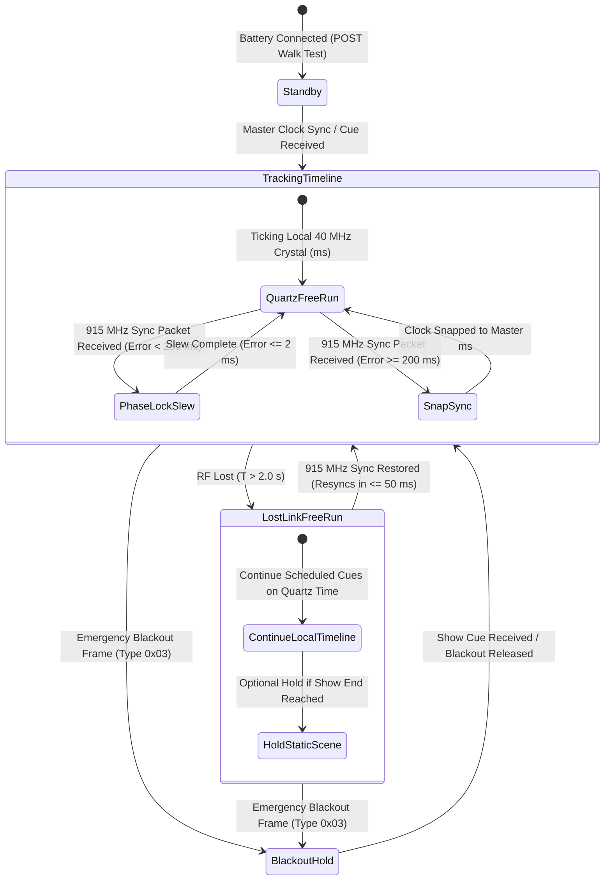

# PCHSMB Universal Lighting Controller — Firmware Architecture

This directory contains the firmware architecture, communications protocols, and driver implementations for the **PCHSMB Universal Field Prop Lighting Control System**.

The platform powers two distinct hardware targets built on the **Heltec WiFi LoRa 32 (V3)** module (Espressif ESP32-S3 dual-core MCU @ 240 MHz + Semtech SX1262 Sub-GHz transceiver):
1. **`synapse_master`:** Master console firmware (cue switch matrix debounce, emergency blackout interrupt, rotary menu, OLED UI, SMPTE/click sync, and 902–928 MHz broadcast engine).
2. **`prop_node`:** Autonomous prop receiver and LED driver firmware (Sub-GHz packet filtering, quartz phase-locked clock synchronization, distributed timeline execution, 8-bit DIP switch hardware serial reading, battery ADC telemetry, and 4-channel parallel DMA pixel output).

---

## 1. Real-Time Dual-Core Execution Model

To satisfy **`REQ-FW-01`** and **`REQ-FW-02`**, both firmware targets strictly isolate time-critical radio communications from high-rate LED pixel rendering across the ESP32-S3's dual symmetric cores:

```
┌──────────────────────────────────────────────────────────────────────────────────────────────────┐
│                                   ESP32-S3 CORE PARTITIONING                                     │
├─────────────────────────────────────────────────┬────────────────────────────────────────────────┤
│ CORE 0: PROTOCOL & REAL-TIME RF ENGINE          │ CORE 1: HARDWARE DMA PIXEL & TIMELINE ENGINE   │
├─────────────────────────────────────────────────┼────────────────────────────────────────────────┤
│ • RadioLib SX1262 Interrupt Handler             │ • FastLED / ESP32-RMT Quad-DMA Driver          │
│ • Sub-GHz 915 MHz RF Packet Transmit/Receive    │ • 4-Channel Parallel Output (800 kHz stream)   │
│ • Packet Sequence & CRC-16 Validation           │ • Autonomous Distributed Timeline Sequencer    │
│ • Millisecond Quartz Clock Phase-Lock (PLL)     │ • Dynamic Color Wave & Chase Generators        │
│ • Battery ADC Telemetry Sampling & UVLO Alarm   │ • Show Cue State Machine & Group Filtering     │
│ • Emergency Spare Re-mapping Handler            │ • Smooth 60 FPS Gamma-Corrected Rendering      │
├─────────────────────────────────────────────────┴────────────────────────────────────────────────┤
│ ◄══════════════════════════ FreeRTOS Queue / Lockless Ring Buffer ═════════════════════════════► │
└──────────────────────────────────────────────────────────────────────────────────────────────────┘
```

---

## 2. Distributed Timeline Architecture & Master Clock Sync

The PCHSMB lighting system operates on a **Distributed Timeline Execution Model**. Rather than streaming raw RGB pixel data across the field in real-time (which creates bandwidth bottlenecks, single-point failures, and freezing when RF packets drop), **every prop node is an autonomous animation engine** hosting its complete show cue timeline in onboard SPI flash memory.

```
===================================================================================================
                   DISTRIBUTED TIMELINE & PHASE-LOCKED SYNC TOPOLOGY
===================================================================================================

  [SYNAPSE PIT MASTER CONSOLE]
    │
    │ Broadcasts 915 MHz Clock Heartbeat (every 500 ms) + Downbeat Cue Triggers
    │ Packet payload: [Sync Word | Frame Type | Seq | Master Show Time (ms) | Active Cue | CRC-16]
    │
    ├─────────────────────────────┬─────────────────────────────┐
    ▼ (915 MHz RF)               ▼ (915 MHz RF)               ▼ (915 MHz RF)
┌──────────────────────┐      ┌──────────────────────┐      ┌──────────────────────┐
│ PROP NODE #1         │      │ PROP NODE #4         │      │ PROP NODE #18        │
│ Hardware DIP: 0x01   │      │ Hardware DIP: 0x04   │      │ Hardware DIP: 0x12   │
│ Flash: Profile 1     │      │ Flash: Profile 4     │      │ Flash: Spare Profile │
│                      │      │                      │      │                      │
│ ┌──────────────────┐ │      │ ┌──────────────────┐ │      │ ┌──────────────────┐ │
│ │ 40 MHz Crystal   │ │      │ │ 40 MHz Crystal   │ │      │ │ 40 MHz Crystal   │ │
│ │ Local Clock (ms) │ │      │ │ Local Clock (ms) │ │      │ │ Local Clock (ms) │ │
│ └────────┬─────────┘ │      │ └────────┬─────────┘ │      │ └────────┬─────────┘ │
│          ▼           │      │          ▼           │      │          ▼           │
│ [Autonomous Engine]  │      │ [Autonomous Engine]  │      │ [Autonomous Engine]  │
│ Cue 1 @ 00:04.20     │      │ Cue 1 @ 00:04.20     │      │ Ready for quick-swap │
│ Cue 2 @ 00:12.80     │      │ Cue 2 @ 00:12.80     │      │ or spare re-mapping  │
│ Cue 3 @ 00:18.43     │      │ Cue 3 @ 00:18.43     │      │                      │
│ (Executes from Flash)│      │ (Executes from Flash)│      │                      │
└──────────────────────┘      └──────────────────────┘      └──────────────────────┘
```

### 2.1 Local Timeline Storage Structure
Each prop node stores a lightweight binary configuration profile (`config.bin` in LittleFS/NVS). Each cue record consumes only 16 bytes:

```c
typedef struct __attribute__((packed)) {
    uint32_t timestamp_ms; // Target show millisecond mark (e.g., 18430 = 00:18.43)
    uint8_t  cue_id;       // Show cue number (1–64)
    uint8_t  effect_type;  // 0x00=Blackout, 0x01=Static, 0x02=Pulse, 0x03=Chase, 0x04=Wave
    uint8_t  color_rgb[3]; // Primary color (R, G, B)
    uint8_t  accent_rgb[3];// Accent / secondary color (R, G, B)
    uint16_t duration_ms;  // Duration of effect before hold/rest
    uint16_t fade_ms;      // Fade-in / transition smoothing time
    uint8_t  brightness;   // Intensity ceiling (1–100%)
    uint8_t  zone_mask;    // Active physical channels (Bits 0–3 = CH1–CH4)
} CueEvent;

typedef struct __attribute__((packed)) {
    uint8_t  assigned_profile_id; // Assigned prop role (e.g. 4 for Backdrop 4)
    uint8_t  num_cues;            // Total cues programmed (e.g. 16)
    CueEvent cues[16];            // 16 downbeat events (16 * 16 = 256 bytes)
    uint16_t checksum;            // CRC-16 of profile data
} PropTimelineConfig;             // Total: exactly 260 bytes!
```

### 2.2 Quartz Crystal Phase-Locked Loop (PLL) Engine
Field timing reliability relies on the Heltec V3's onboard **$40\,	ext{MHz}$ quartz crystal oscillator**:
- **Uncorrected Drift:** Commercial quartz crystals exhibit a frequency tolerance of $\le \pm 20\,	ext{ppm}$. Over a maximum 12-minute ($720\,	ext{second}$) competitive field show, the maximum drift without any radio sync is:
  $$\Delta t_{	ext{max}} = 720\,	ext{s} 	imes 20 	imes 10^{-6} = 0.0144\,	ext{s} = 14.4\,	ext{ms}$$
  This is less than a single video frame ($16.6\,	ext{ms}$ at 60 FPS) and imperceptible to human adjudicators.
- **RF Role — Drift Correction Heartbeat:** The 915 MHz broadcast from Synapse sends a millisecond clock-sync heartbeat (`Frame Type = 0x02`, payload: `uint32_t master_show_ms`) every $500\,	ext{ms}$.
- **PLL Slew Logic:**
  - Upon receiving `master_show_ms`, the prop calculates the clock error: $\epsilon = 	ext{master\_show\_ms} - 	ext{local\_ms}$.
  - If $|\epsilon| \le 200\,	ext{ms}$, the local clock slews smoothly toward master time at $\le 0.5\,	ext{ms}$ per millisecond. This prevents visual snapping or optical tearing during chases.
  - If $|\epsilon| > 200\,	ext{ms}$ (e.g. after a manual director cue jump or console restart), the clock snaps immediately to master time.
- **RF Loss Immunity:** If the RF signal is lost or jammed, **animations continue playing uninterrupted on local quartz time**. When the RF signal returns, the PLL gently slews any accumulated sub-millisecond drift back into absolute phase.

---

## 3. 8-Bit Hardware DIP Switch & Spare Re-Mapping Workflow

Carrier board `PCB-PROP-NODE-V1` features an **8-position slide DIP switch (`SW1`)** connected to ESP32-S3 GPIO pins 2, 3, 4, 5, 7, 8, 9, 10 with internal pullups.

```
       SW1: 8-BIT HARDWARE DEVICE SERIAL ID (0–255 / 0x00–0xFF)
       Pin 1 ── GPIO 2  (Bit 0, 1s)       Pin 16 ── GND
       Pin 2 ── GPIO 3  (Bit 1, 2s)       Pin 15 ── GND
       Pin 3 ── GPIO 4  (Bit 2, 4s)       Pin 14 ── GND
       Pin 4 ── GPIO 5  (Bit 3, 8s)       Pin 13 ── GND
       Pin 5 ── GPIO 7  (Bit 4, 16s)      Pin 12 ── GND
       Pin 6 ── GPIO 8  (Bit 5, 32s)      Pin 11 ── GND
       Pin 7 ── GPIO 9  (Bit 6, 64s)      Pin 10 ── GND
       Pin 8 ── GPIO 10 (Bit 7, 128s)     Pin 9  ── GND
```

### Decoupling Hardware Serial from Show Profile
The 8-bit DIP switch establishes the node's **permanent physical hardware serial number** (`0`–`255`). All receiver nodes run the exact same firmware binary. The node looks up its show timeline based on its local configuration profile:

- By default, Hardware Serial $N$ loads Profile $N$ (`hw_serial == prop_profile_id`).
- When a unit suffers physical field damage (e.g. Backdrop Unit 4 suffers a broken frame or dead battery) and spare Unit 18 is rushed in:

#### Workflow A: Off-Field / Rehearsal Re-mapping (Wi-Fi OTA)
1. Staff connects a smartphone, tablet, or laptop to Unit 18's local Wi-Fi SoftAP (`PCHSMB-NODE-18`).
2. The user selects **"Emulate Prop Profile: 4"** (or uploads `prop04.bin`).
3. Unit 18 flashes the 260-byte profile to LittleFS in $< 2.0\,	ext{s}$ and reboots ready for service as Backdrop 4.

#### Workflow B: On-Field Emergency Re-mapping (915 MHz Quick-Remap Packet)
If a prop fails immediately before gate ingress with no time for Wi-Fi or laptops:
1. Crew member brings spare Unit 18 onto the field and places it at the Prop 4 station.
2. The pit operator navigates to the Synapse OLED menu: `SPARE REMAP -> HW: 018 -> PROFILE: 004 -> CONFIRM`.
3. Synapse transmits a high-priority 915 MHz configuration frame (`Frame Type = 0x05`, targeted to HW ID 18, carrying Prop 4's timeline data).
4. Unit 18 receives the packet, writes the configuration in $< 50\,	ext{ms}$, and instantly joins the show timeline in tight phase synchronization.

---

## 4. Wireless Broadcast Protocol Specification

The master broadcast link operates at **915.0 MHz** using high-efficiency FSK / LoRa modulation optimized for low latency and zero packet collision across the 100-yard stadium field.

### Packet Frame Definitions

#### A. Standard Show Cue & Clock Sync Frame (Fixed 16-Byte Payload)
```
Byte 0-1:   Sync Word (0x50, 0x43 - 'PC' for Pine Creek)
Byte 2:     Frame Type:
              0x01 = Downbeat Cue Trigger
              0x02 = Clock Sync Heartbeat (Master Milliseconds)
              0x03 = Preemptive Emergency Blackout
              0x04 = Telemetry Ping / Status Request
              0x05 = Spare Unit Emergency Re-map
Byte 3:     Packet Sequence Counter (0–255 rolling counter)
Byte 4-7:   Master Show Milliseconds (uint32_t, elapsed show time: 0 to 720,000 ms)
Byte 8:     Active Cue Number (1–64)
Byte 9:     Target Prop Group Mask (Bit 0 = All, Bit 1 = Backdrops, Bit 2 = Screens, Bit 3 = Stages...)
Byte 10:    Global Intensity Ceiling (1–100%)
Byte 11-13: Parameter Payload / Optional Real-Time Override
Byte 14-15: CRC-16-CCITT (Polynomial 0x1021)
```

#### B. Emergency Quick-Remap Frame (`Frame Type = 0x05`)
```
Byte 0-1:   Sync Word (0x50, 0x43)
Byte 2:     Frame Type = 0x05 (SPARE_REMAP)
Byte 3:     Target Hardware Serial ID (0–255, e.g. 18)
Byte 4:     Assigned Prop Profile ID (0–255, e.g. 4)
Byte 5:     Command Flags (0x01 = Apply & Persist to Flash, 0x02 = Test Tone)
Byte 6-13:  Profile Digest / Flash Pointer
Byte 14-15: CRC-16-CCITT
```

- **Unacknowledged Low-Latency Broadcast:** Packets are transmitted unidirectionally without individual ACK handshakes, eliminating the "ACK storm" failure mode typical of large mesh networks.
- **Preemptive Emergency Blackout:** Blackout packets (`Frame Type = 0x03`) are triggered via hardware pin interrupt and transmitted 3 times in immediate succession ($T \le 5.0\,	ext{ms}$) to guarantee reception even through heavy transient RF interference.

---

## 5. Four-Channel Parallel DMA Pixel Engine

To drive up to four independent physical zones per prop (e.g. perimeter rails, inner graphic accent, downward ground wash, and ancillary runner) without CPU starvation:
- Firmware configures the ESP32-S3's internal **RMT (Remote Control) peripheral** with dedicated DMA channels.
- Data for all 4 channels (up to 510 WS2812B/SK6812 pixels total) is prepared in non-blocking double buffers on Core 1.
- The DMA engine clocks the raw $800\,	ext{kHz}$ pulse train directly into the 74AHCT125 level-shifter ICs with **zero processor wait states**.
- Frame rate is locked at **$60.0\,	ext{FPS}$**, providing silky smooth color fades and high-speed chases.

---

## 6. Autonomous Lost-Link Fail-Safe State Machine

To prevent props from glitching or flashing if a large metal stadium object momentarily shadows the RF line-of-sight:



---

## 7. Firmware Deployment & Precompiled Binaries

Field prop nodes are flashed **once during initial bench fabrication** with the universal firmware binary. **They never need to be reflashed for new show seasons**. All seasonal show logic is governed by the CSV configuration file and streamed/synced over the air.

### Factory Binaries (Under `firmware/releases/`):
- `synapse_master_v1.0.bin`: Flashed to the front-ensemble master console.
- `prop_node_receiver_v1.0.bin`: Flashed to all peripheral prop nodes.

Flashing is performed via standard USB-C using the web-based Espressif Flash Tool or PlatformIO:
```bash
# Flash Prop Node Receiver via USB-C
esptool.py --chip esp32s3 write_flash 0x0 prop_node_receiver_v1.0.bin

# Flash Synapse Master Console via USB-C
esptool.py --chip esp32s3 write_flash 0x0 synapse_master_v1.0.bin
```
