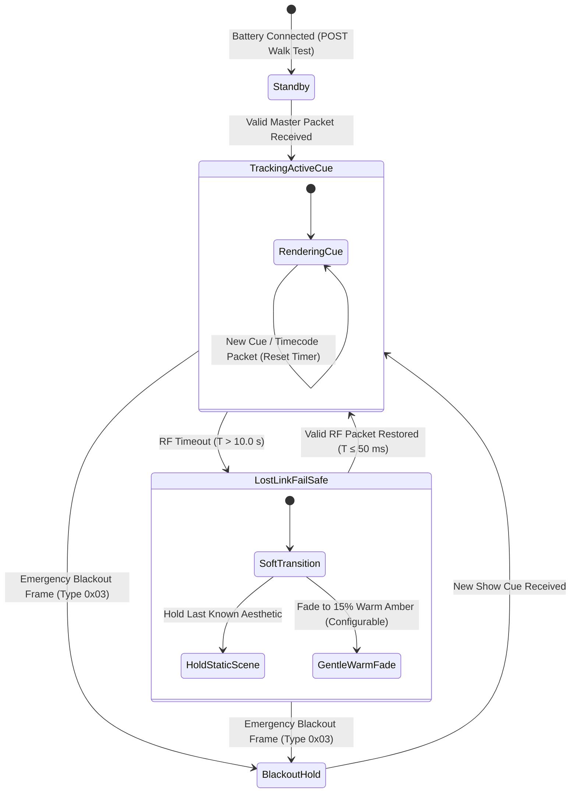

# PCHSMB Universal Lighting Controller — Firmware Architecture

This directory contains the firmware architecture, communications protocols, and driver implementations for the **PCHSMB Universal Field Prop Lighting Control System**.

The platform powers two distinct hardware targets built on the **Heltec WiFi LoRa 32 (V3)** module (Espressif ESP32-S3 dual-core MCU @ 240 MHz + Semtech SX1262 Sub-GHz transceiver):
1. **`synapse_master`:** Master console firmware (cue switch matrix debounce, emergency blackout interrupt, rotary menu, OLED UI, SMPTE/click sync, and 902–928 MHz broadcast engine).
2. **`prop_node`:** Autonomous prop receiver and LED driver firmware (Sub-GHz packet filtering, phase-locked clock synchronization, lost-link fail-safe state machine, hardware ID rotary dial reading, battery ADC telemetry, and 4-channel parallel DMA pixel output).

---

## 1. Real-Time Dual-Core Execution Model

To satisfy **`REQ-FW-01`** and **`REQ-FW-02`**, both firmware targets strictly isolate time-critical radio communications from high-rate LED pixel rendering across the ESP32-S3's dual symmetric cores:

```
┌──────────────────────────────────────────────────────────────────────────────────────────────────┐
│                                   ESP32-S3 CORE PARTITIONING                                     │
├─────────────────────────────────────────────────┬────────────────────────────────────────────────┤
│ CORE 0: PROTOCOL & REAL-TIME RF ENGINE          │ CORE 1: HARDWARE DMA PIXEL & SHOW STATE ENGINE │
├─────────────────────────────────────────────────┼────────────────────────────────────────────────┤
│ • RadioLib SX1262 Interrupt Handler             │ • FastLED / ESP32-RMT Quad-DMA Driver          │
│ • Sub-GHz 915 MHz RF Packet Transmit/Receive    │ • 4-Channel Parallel Output (800 kHz stream)   │
│ • Packet Sequence & CRC-16 Validation           │ • Procedural Parametric Effect Interpolator    │
│ • Millisecond Master Clock Phase-Lock           │ • Dynamic Color Wave & Chase Generators        │
│ • Battery ADC Telemetry Sampling & UVLO Alarm   │ • Show Cue State Machine & Group Filtering     │
│ • Lost-Link Fail-Safe Watchdog (T > 10.0 s)     │ • Smooth 60 FPS Gamma-Corrected Rendering      │
├─────────────────────────────────────────────────┴────────────────────────────────────────────────┤
│ ◄══════════════════════════ FreeRTOS Queue / Lockless Ring Buffer ═════════════════════════════► │
└──────────────────────────────────────────────────────────────────────────────────────────────────┘
```

---

## 2. Wireless Broadcast Protocol Specification

The master broadcast link operates at **915.0 MHz** using high-efficiency FSK / LoRa modulation optimized for low latency and zero packet collision across the 100-yard stadium field.

### Packet Frame Definition (Fixed 16-Byte Payload)
```
Byte 0-1:  Sync Word (0x50, 0x43 - 'PC' for Pine Creek)
Byte 2:    Frame Type (0x01 = Cue Trigger, 0x02 = Clock Sync, 0x03 = Blackout, 0x04 = Telemetry Ping)
Byte 3:    Packet Sequence Counter (0–255 rolling counter)
Byte 4:    Active Cue Number (1–64)
Byte 5:    Target Prop Group Mask (Bit 0 = All, Bit 1 = Backdrops, Bit 2 = Screens, Bit 3 = Stages...)
Byte 6:    Effect Type ID (0x00 = Blackout, 0x01 = Static, 0x02 = Pulse, 0x03 = Chase, 0x04 = Strobe...)
Byte 7-9:  Primary RGB Color (R, G, B, 0–255 each)
Byte 10:   Secondary RGB Color Index / Accent Color
Byte 11:   Duration / Speed Parameter (Scaled 0.1s units)
Byte 12:   Fade Time Parameter (Scaled 0.1s units)
Byte 13:   Master Brightness Scaling (1–100%)
Byte 14-15: CRC-16-CCITT (Polynomial 0x1021)
```

- **Unacknowledged Low-Latency Broadcast:** Packets are transmitted unidirectionally without individual ACK handshakes, eliminating the "ACK storm" failure mode typical of large mesh networks.
- **Preemptive Emergency Blackout:** Blackout packets (`Frame Type = 0x03`) are triggered via hardware pin interrupt and transmitted 3 times in immediate succession ($T \le 5.0\,\text{ms}$) to guarantee reception even through heavy transient RF interference.

---

## 3. Four-Channel Parallel DMA Pixel Engine

To drive up to four independent physical zones per prop (e.g. perimeter rails, inner graphic accent, downward ground wash, and ancillary runner) without CPU starvation:
- Firmware configures the ESP32-S3's internal **RMT (Remote Control) peripheral** with dedicated DMA channels.
- Data for all 4 channels (up to 510 WS2812B/SK6812 pixels total) is prepared in non-blocking double buffers on Core 1.
- The DMA engine clocks the raw $800\,\text{kHz}$ pulse train directly into the 74AHCT125 level-shifter ICs with **zero processor wait states**.
- Frame rate is locked at **$60.0\,\text{FPS}$**, providing silky smooth color fades and high-speed chases.

---

## 4. Autonomous Lost-Link Fail-Safe State Machine

To prevent props from glitching or flashing if a large metal stadium object momentarily shadows the RF line-of-sight:


---

## 5. Firmware Deployment & Precompiled Binaries

Field prop nodes are flashed **once during initial bench fabrication** with the universal firmware binary. **They never need to be reflashed for new show seasons**. All show logic is transmitted dynamically over the air from the Synapse master console.

### Factory Binaries (Under `firmware/releases/`):
- `synapse_master_v1.0.bin`: Flashed to the front-ensemble master console.
- `prop_node_receiver_v1.0.bin`: Flashed to all peripheral prop nodes.

Flashing is performed via standard USB-C using the web-based Espressif Flash Tool or PlatformIO:
```bash
# Flash Prop Node Receiver via USB-C
esptool.py --chip esp32s3 write_flash 0x0 prop_node_receiver_v1.0.bin

# Flash Synapse Master Console via USB-C
esptool.py --chip esp32s3 write_flash 0x0 synapse_master_v1.0.bin
```
