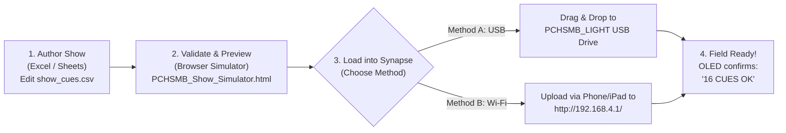

# PCHSMB Universal Lighting Controller — Software & Show Reprogramming Suite

This directory contains the software architecture, show definition templates, and non-technical reprogramming tools for the **PCHSMB Universal Field Prop Lighting Control System**.

---

## 1. The Zero-Software & Zero-AI Reprogramming Philosophy

A central engineering requirement (**`REQ-SW-01`**) of the PCHSMB platform is that **no specialized software development, coding skills, IDE installation, or artificial intelligence prompting is ever required to reprogram a new marching band production**.

High school band directors, visual caption heads, and student section leaders change from year to year. Requiring specialized command-line tooling, Python compilers, or AI prompts guarantees system obsolescence.

Instead, the PCHSMB system uses **open, universal data standards** (CSV spreadsheets) and **plug-and-play browser interfaces**:
1. **Show Authoring:** Done in standard spreadsheet software (**Microsoft Excel, Google Sheets, Apple Numbers**).
2. **Show Ingestion:** Done via simple **USB flash drive drag-and-drop** OR an **offline mobile Web Portal** on a phone/tablet.
3. **Show Verification:** Done using a single-file, zero-install **HTML5 Field Simulator** in any web browser.

---

## 2. Non-Technical Workflow: Step-by-Step



### Step 1: Author the Show in a Spreadsheet
Open [`show_cues_template.csv`](show_cues_template.csv) in Excel, Google Sheets, or Numbers. Enter your 16 cue names, trigger buttons, target prop groups, colors, and effects.

| Field Name | Description | Example Values |
|---|---|---|
| `Cue_Number` | Order index (1–16) | `1`, `2` ... `16` |
| `Cue_Name` | Short human label (for OLED display) | `Opener_Hit`, `Ballad_Bloom` |
| `Trigger_Source` | Trigger input type | `BUTTON_1` through `BUTTON_16`, `AUTO_TIME`, `AUDIO_CLICK` |
| `Target_Group` | Which props execute this cue | `ALL`, `BACKDROPS`, `SCREENS`, `STAGES`, `SOLOIST`, `PROP_01`..`PROP_64` |
| `Effect_Type` | Dynamic procedural lighting algorithm | `STATIC`, `FADE_IN`, `FADE_OUT`, `DYNAMIC_PULSE`, `CHASE_HORIZ`, `PULSE_UP`, `STROBE`, `SPARKLE`, `COLOR_WAVE`, `BLACKOUT` |
| `Primary_Color` | Main hue (hex or standard name) | `#FF8800`, `AMBER`, `GOLD`, `CYAN`, `WHITE`, `NAVY` |
| `Secondary_Color` | Accent or chase contrast hue | `#00D4FF`, `GOLD`, `WHITE` |
| `Duration_Sec` | Total effect run time in seconds | `4.0`, `12.5`, `24.0` |
| `Fade_Time_Sec` | Ramp-in / transition smoothing | `0.5`, `2.0` |
| `Brightness_Pct` | Master intensity limit (1–100%) | `100`, `85`, `40` |

### Step 2: Test in the Offline HTML5 Simulator
Double-click [`PCHSMB_Show_Simulator.html`](PCHSMB_Show_Simulator.html) to open the interactive field visualizer in Google Chrome, Safari, or Microsoft Edge.
- Drag and drop your updated `show_cues.csv` file into the validator.
- The simulator audits every row for valid colors, numbers, and syntax.
- Click virtual buttons 1–16 to watch your field props (Backdrops, Sideline Screens, Soloist Stage, Star Tarp) animate in real-time on a virtual football field grid!

### Step 3: Load into Synapse Master Console

#### Method A: Direct USB Drag-and-Drop (Easiest)
1. Plug a standard USB-C cable from your computer into the Synapse console.
2. The console mounts on your desktop as an external USB flash drive named **`PCHSMB_LIGHT`**.
3. Drag your saved `show_cues.csv` into the drive.
4. Eject the drive. Synapse instantly validates the file, flashes it to internal memory, and displays:
   ```
   [ SHOW LOADED ]
   BEACON 2027
   16 CUES VALIDATED
   READY FOR SHOW
   ```

#### Method B: Sideline Wi-Fi Web Portal (From Phone or iPad)
1. On the Synapse console, turn the rotary knob to `CONFIG MODE` and press the knob.
2. The console broadcasts a secure local Wi-Fi network: **`PCHSMB-Lighting-Config`** (password: `pinecreek`).
3. Connect your smartphone, iPad, or laptop to this Wi-Fi network.
4. Open any browser to `http://192.168.4.1/`.
5. Tap **"Upload Show File"** and select your CSV, or use the interactive web sliders to tweak cue timings, colors, and live test props on the field!

---

## 3. Automated Error Protection & Safety Fail-Safes

If a user makes a typo in Excel (e.g. typing `"bluish"` instead of a valid hex color, or setting brightness to `"150%"`):
1. **No System Crash:** The console safely rejects the corrupted file and continues running the previously loaded show profile.
2. **OLED Notification:** The console screen displays `LOAD ERROR: ROW 4 - SEE LOG`.
3. **Plain-English Error Log:** An `error_log.txt` file is generated on the USB drive with exact, helpful instructions:
   ```
   ======================================================================
   PCHSMB LIGHTING SYSTEM — CUE VALIDATION REPORT
   ======================================================================
   STATUS: REJECTED (Previous show profile retained)
   
   ERROR in Row 4 (Cue 'Ballad_Bloom'):
     - Column 'Brightness_Pct': Value '150' exceeds maximum allowed (100).
     - Column 'Primary_Color': 'bluish' is unrecognized. Please use a 6-digit
       hex code (e.g. #0088FF) or standard name (AMBER, CYAN, GOLD, WHITE).
   ======================================================================
   ```

---

## 4. Multi-Show Flash Storage
The Synapse console stores up to **4 distinct show profiles** in permanent memory, switchable via the rotary encoder in $< 5\,\text{seconds}$:
- **Profile 1:** Competition Show (Full field choreography)
- **Profile 2:** Halftime Show (Simplified student triggers)
- **Profile 3:** Stand Tunes (Crowd energizer pulses)
- **Profile 4:** Field Rehearsal / Bench Test
