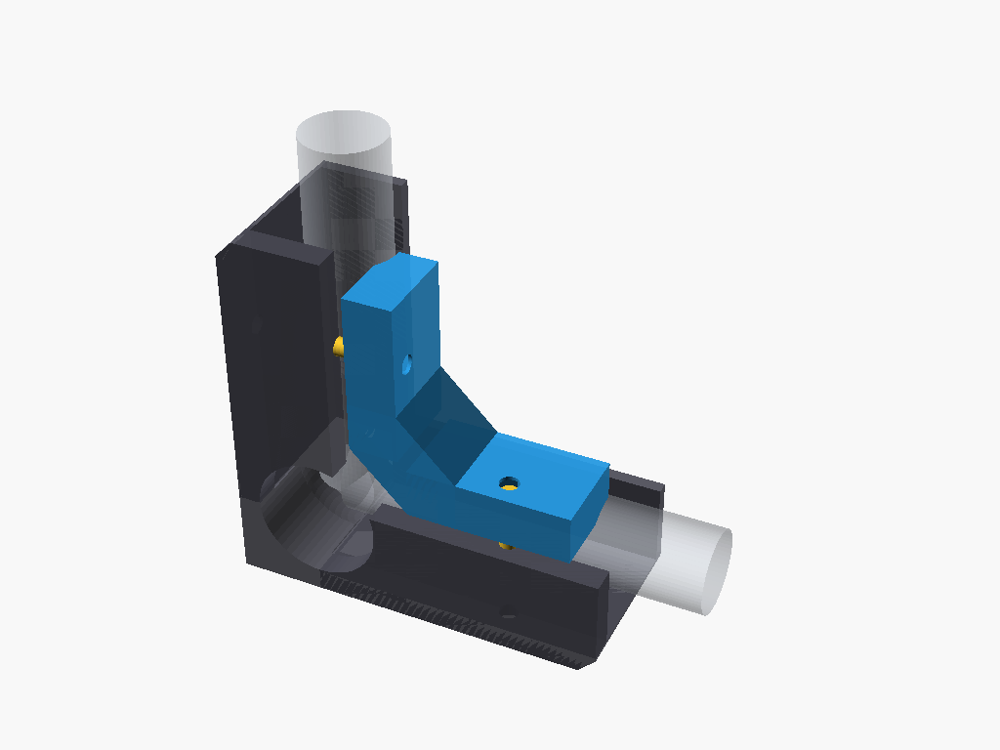
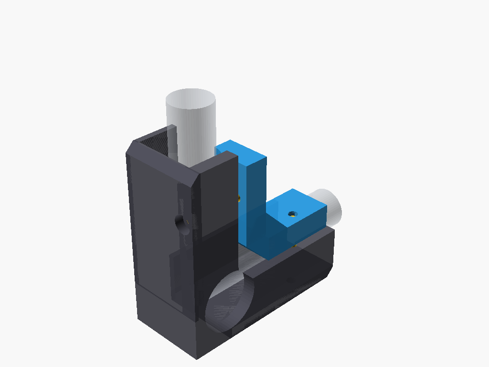
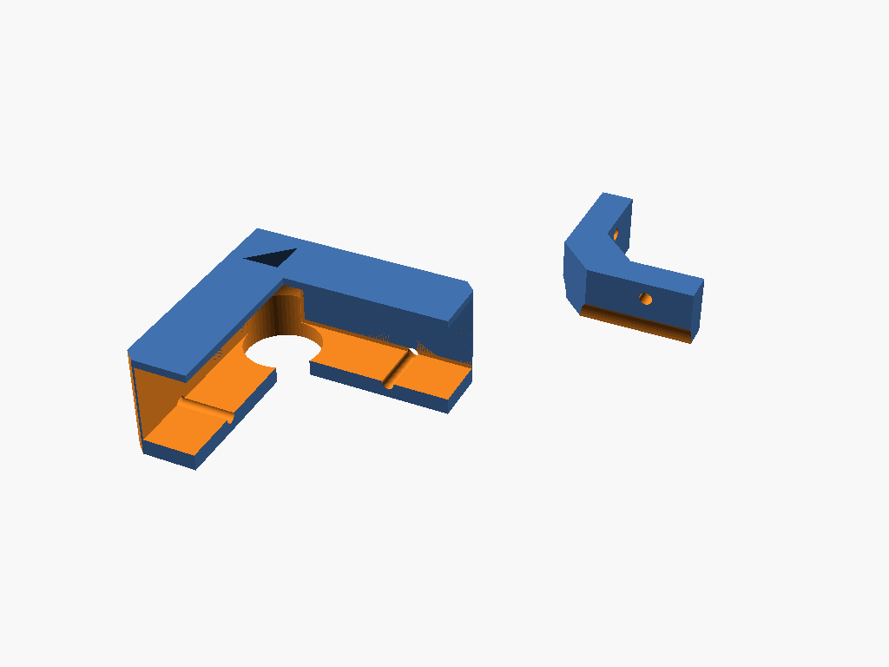

# PCHSMB Duck Blind — Universal Two-Piece Corner Protector Subproject

The **Universal Two-Piece Corner Protector** is a heavy-duty, 3D-printed sacrificial wear shoe, corner bumper, and clamp assembly designed specifically for the Pine Creek High School Marching Band (PCHSMB) **Sideline Screen / Duck Blind** fleet (nominal 4 ft × 8 ft folding props).

| Assembled Protector (Rear / Inside Cutaway View) | Front Protective Shield (Display Face) | Dual-Print Plate Setup (Piece 1 + Piece 2) |
| :---: | :---: | :---: |
|  |  |  |

---

## 1. Problem Statement & Design Evolution

### The Physical Wear Mechanism:
On each Duck Blind screen, custom-printed 13 oz scrim vinyl wraps around the perimeter of the 3/4" EMT electrical conduit frame and over the four 3-way corner elbow brackets (Bracket *F*, Amazon `B0D5BBKCKG`).
- **Ground Protrusion:** Bracket *F* has an outer diameter of $\sim 27.2\text{ mm}$, protruding **$1.89\text{ mm}$ lower than the conduit rail**.
- **Severe Ground Dragging:** When screens are dragged across synthetic turf, asphalt tracks, or concrete staging areas, Bracket *F* bears the normal load, subjecting the folded vinyl graphics to severe abrasion, puncture, and ink delamination.

### The Two-Piece Clamping Paradigm:
Earlier designs attempted to snap onto bare conduit inboard of Bracket *F*. The new **Two-Piece Universal Corner Protector** dispenses with conduit snapping entirely, instead clamping rigidly directly over Bracket *F*:
1. **Single Common Component (Zero Handedness):** The bracket is 100% mathematically symmetric across the 45° corner diagonal ($X = Z$). A single common pair of parts works interchangeably on **both the bottom-left and bottom-right corners** (no separate "Left" or "Right" files!).
2. **Piece 1 — Primary Outside Skid Shoe & Corner Bumper:**
   - Covers the **front face** (shielding the vinyl banner without wrapping into the screen display opening).
   - Wraps around the **outside perimeter** (providing a thick $6.0\text{ mm}$ sacrificial bottom runner and side bumper).
   - Continues up the **rear/inside face** with a circular relief cutout ($\varnothing 35\text{ mm}$) for Bracket *F*'s unused 3rd socket and Corner Plug *H*.
   - **Loose Tolerances:** Features a generous $36.0\text{ mm}$ internal trough ($+8.8\text{ mm}$ diametral clearance over Bracket *F*), effortlessly swallowing multi-layer bunched vinyl folds, seams, and double-sided mounting tape.
   - **Slip-On Installation:** Slips straight onto the corner from the outside along the 45° diagonal.
3. **Piece 2 — Inside Clamp Block & Nut Retainer:**
   - Installs from the inside crook of the 90° frame angle.
   - Dual concave saddles ($R = 14.5\text{ mm}$) seat firmly against the inside curve of the bracket sleeves.
   - **Zero Ground Contact:** Suspended **$+35.5\text{ mm}$ ($1.4\text{ in.}$) above the ground**, completely shielded from turf friction and impact.
   - **Captured Hex Nuts:** Houses two recessed hex nut pockets for standard M5 (or #10-24) nuts. The fabricator needs only a single hex key from the outside; no wrench is required to hold nuts during assembly.
4. **Fastener Retention & Normal Clamping:**
   - Clamped by two orthogonal bolts: one vertical bolt on Rail *A* ($X = 54.0\text{ mm}$) and one horizontal bolt on Rail *B* ($Z = 54.0\text{ mm}$).
   - Both bolts enter through **deeply recessed counterbores ($5.0\text{ mm}$ depth)** in Piece 1, keeping bolt heads completely sub-flush and safe from ground contact.
   - Tightening the bolts draws Piece 2 tightly into Piece 1, compressing the corner bracket and vinyl padding with zero slippage or play.

---

## 2. Dimensional Stack-Up & Mechanical Verification

| Feature / Interface | Physical Assembly Target | Corner Protector Modeled Spec | Clearance / Margin | Function / Rationale |
|---|:---:|:---:|:---:|---|
| **Bracket Sleeve OD** | $27.20\text{ mm}$ (stamped steel) | **$36.00\text{ mm}$** ($pocket\_dia$) | **$+8.80\text{ mm}$** diametral | Loose tolerance for bunched vinyl banner & tape |
| **Sleeve Length Enclosure** | $70.00\text{ mm}$ (bracket sleeve) | **$82.00\text{ mm}$** ($arm\_len$) | **$+12.00\text{ mm}$** axial | Completely swallows bracket sleeve with margin |
| **Sacrificial Wear Thickness** | N/A | **$6.00\text{ mm}$ solid** | Under bracket | Sacrificial wear pad for season dragging |
| **Ground Elevation Below Conduit**| $11.71\text{ mm}$ (conduit bottom) | **$24.00\text{ mm}$** ($Z_{\text{skid}}$) | **$+12.29\text{ mm}$** | Elevates bottom rail vinyl high off ground |
| **Ground Elevation Below Bracket**| $13.60\text{ mm}$ (bracket bottom) | **$24.00\text{ mm}$** ($Z_{\text{skid}}$) | **$+10.40\text{ mm}$** | Elevates corner bracket completely off ground |
| **Piece 2 Ground Clearance** | Ground plane ($Z = -24.0\text{ mm}$) | **$Z_{\text{min}} = +11.50\text{ mm}$** | **$+35.50\text{ mm}$ ($1.40\text{ in.}$)** | 100% zero ground contact guaranteed |
| **Glide Contact Width** | N/A | **$47.00\text{ mm}$ flat** | Ground plane | Wide stable contact patch; prevents tipping |
| **Bolt 1 Position (Rail A)** | Rail A centerline | **$X = 54.0\text{ mm}, Y = -18.5\text{ mm}$** | Vertical ($Z$-axis) | Passes behind conduit into Piece 2 top nut |
| **Bolt 2 Position (Rail B)** | Rail B centerline | **$Z = 54.0\text{ mm}, Y = -18.5\text{ mm}$** | Horizontal ($X$-axis) | Passes behind conduit into Piece 2 side nut |
| **Fastener Specification** | Standard hardware | **M5 x 40mm or #10-24 x 1.5"** | Standard metric / imperial | Counterbored heads, captured hex nuts |
| **Rear Socket Relief Hole** | $\varnothing 27.2\text{ mm}$ 3rd socket | **$\varnothing 35.00\text{ mm}$** ($R = 17.5\text{ mm}$)| $+7.80\text{ mm}$ diametral | Zero interference with Corner Plug *H* |

---

## 3. Production Files & Deliverables

All production files are authored parametrically in OpenSCAD (`corner_protector.scad`) and rendered headlessly via OpenSCAD CLI:

| Component / Deliverable | File Path / Link | Purpose | Est. Print Mass (ASA / PETG) |
|---|---|---|:---:|
| **Piece 1 (Outside Skid Shoe)** | [`corner_protector_piece1_outside.stl`](corner_protector_piece1_outside.stl) | Primary wear shoe, front shield & corner bumper | ~95.8g ASA / ~113.7g PETG |
| **Piece 2 (Inside Clamp Block)**| [`corner_protector_piece2_inside.stl`](corner_protector_piece2_inside.stl) | Inside saddle clamp & captured hex nut block | ~35.9g ASA / ~42.6g PETG |
| **Complete Corner Set (Plate)** | [`corner_protector_pair.stl`](corner_protector_pair.stl) | Dual-print plate (Piece 1 + Piece 2 for 1 corner) | ~131.7g ASA / ~156.3g PETG |
| **Parametric OpenSCAD Model** | [`corner_protector.scad`](corner_protector.scad) | Authoritative source of truth CAD model | N/A |
| **Hermetic Verification Suite**| [`test_corner_protector.py`](test_corner_protector.py) | Unittest suite validating topology & dimensions | N/A |

> **Hardware Parent Directory Synchronization:** Production STLs are mirrored to [`PCHSMB/_Sideline Screen/Hardware/`](../):
> - `Hardware/Corner Protector Piece 1 Outside.stl`
> - `Hardware/Corner Protector Piece 2 Inside.stl`
> - `Hardware/Corner Protector Pair.stl`

---

## 4. Recommended 3D Printing Parameters

Print all components in **Black ASA** (preferred for maximum UV stability, heat resistance, and toughness) or **UV-stabilized PETG**. **Do not use PLA** (PLA warps in summer sunlight and fractures under field impacts).

| Parameter | Piece 1 (Outside Piece) | Piece 2 (Inside Piece) |
|---|---|---|
| **Print Orientation** | **Flat on front face** ($+Y$ face down on bed) | **Flat on rear face** ($-Y$ face down on bed) |
| **Supports** | **NONE (100% Zero Supports)** | **NONE (100% Zero Supports)** |
| **Nozzle Diameter** | 0.40 mm (or 0.60 mm for high speed) | 0.40 mm |
| **Layer Height** | 0.20 mm | 0.20 mm |
| **Wall Loops / Perimeters** | **5 loops** ($2.0\text{ mm}$ solid perimeter shell) | **4 loops** ($1.6\text{ mm}$ shell) |
| **Top / Bottom Shells** | **6 shells** ($1.2\text{ mm}$ solid skin) | **5 shells** ($1.0\text{ mm}$ skin) |
| **Infill** | **40% Gyroid** | **40% Gyroid** |
| **Print Time (Pair Set)** | **~3 hr 15 min** (Bambu X1C / P1S) | Fast batch fleet production |

---

## 5. Hardware BOM & Assembly Instructions

### Fastener BOM (Per Screen):
- **4x** M5 × 40 mm (or #10-24 × 1.5 in.) Socket Head Cap Screws (Grade 8.8 or 304 Stainless Steel)
- **4x** M5 (or #10-24) Standard Hex Nuts
- *(Two fasteners per corner set; four fasteners total for the two bottom corners of one Duck Blind screen).*

### Step-by-Step Installation:
1. **Banner Tensioning:** Complete banner stretching and tape application per Section 2.9.2 of the Duck Blind manual. Fold corner bleed tabs flat over Bracket *F*.
2. **Nut Preparation:** Press one hex nut into each of the two hexagonal pockets in Piece 2 (Inside Clamp Block). Nuts seat snugly in the captured hex pockets without falling out.
3. **Position Piece 1:** Take Piece 1 (Outside Skid Shoe). Position it at the bottom corner of the frame. Slide it over the corner bracket from the outside corner along the 45° diagonal:
   - The front face glides over the front of the vinyl banner.
   - The rear cutout clears Bracket *F*'s 3rd rear socket and Corner Plug *H*.
   - The generous internal pocket effortlessly swallows all bunched vinyl folds.
4. **Position Piece 2:** Drop Piece 2 into the inside crook of Bracket *F* (between horizontal Rail *A* and vertical Rail *B*). The concave saddles seat firmly over the inside curves of the two bracket sleeves.
5. **Bolt Fastening:**
   - Insert one M5 × 40 mm bolt vertically through the recessed bottom counterbore of Piece 1 (Rail *A*). Thread into the captured nut in Piece 2.
   - Insert the second M5 × 40 mm bolt horizontally through the recessed outer side counterbore of Piece 1 (Rail *B*). Thread into the captured nut in Piece 2.
   - Tighten both bolts firmly with a 4 mm (or 1/8") hex Allen wrench until Piece 1 and Piece 2 clamp solidly around Bracket *F*.
6. **Repeat:** Install the identical second corner set on the opposite bottom corner of the screen. Both corners use the exact same common component!
