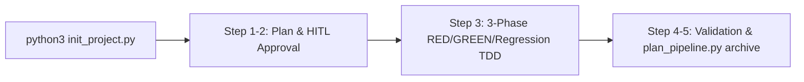

# Plan 01: Initial Architecture & Plan Pipeline Bootstrap

## 1. Goal Description

Initialize the repository domain profile, establish baseline architecture and test coverage, and verify the 5-step Plan Pipeline workflow.

---

## 2. Architecture & Workflow Diagram



---

## 3. Code Modifications

- **`[MODIFY]`** [`AGENTS.md`](../../AGENTS.md): Configure project domain and architecture overview.
- **`[MODIFY]`** [`plan-pipeline.yaml`](../../plan-pipeline.yaml): Set project name and test runner command.

---

## 4. Test Updates & Specifications

- **`[MODIFY]`** [`tests/test_template_integrity.py`](../../tests/test_template_integrity.py): Verify all universal skills, pointer files, and plan validation rules pass.

---

## 5. Documentation Updates

- **`[MODIFY]`** [`README.md`](../../README.md): Document project setup and architecture.

---

## 6. Verification Plan

### Automated Tests
```bash
./run_tests.sh
python3 scripts/plan_pipeline.py validate --all
```

### Manual Verification
1. Run `python3 scripts/plan_pipeline.py status` and confirm `Plan 01` is listed as `VALID`.
